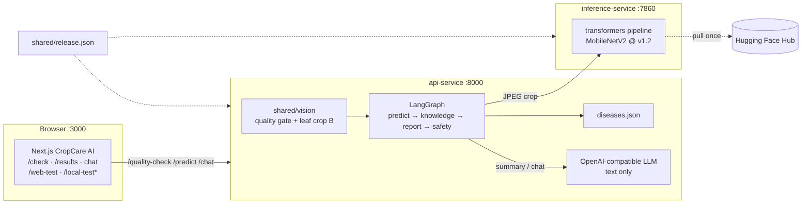
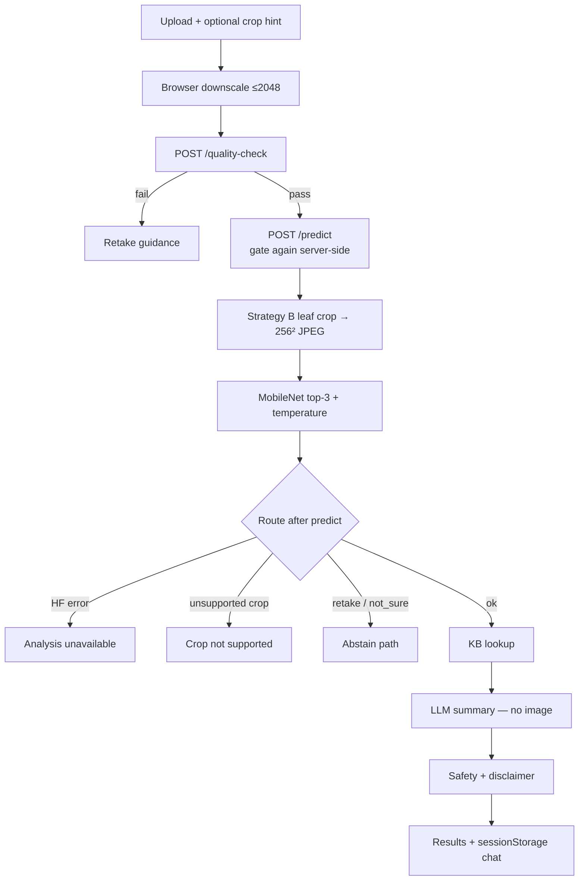

# System architecture

Deliverable view of CropCare AI as implemented. Pin:
`neghani/plantvillage-mobilenetv2@v1.2` (`shared/release.json`).

## 1. Runtime (Docker Compose)

Three processes. Browser talks only to the API host port; API talks to inference over
Compose DNS.



\*Local Test nav only if `localStorage["local-test"] === "true"`.

| Service | Port | Role |
|---------|------|------|
| `ui-service` | 3000 | Next.js (build arg `NEXT_PUBLIC_API_URL=http://localhost:8000`) |
| `api-service` | 8000 | FastAPI, gate, LangGraph, KB, LLM client |
| `inference-service` | 7860 | Torch + transformers; Hub weights from pin |

Optional profile `cropcare`: one container (Render/Railway-style). Same logical layout inside.

## 2. Farmer check request path



## 3. LangGraph (after the gate)

Gate runs **before** the graph in the API. Graph state is `DiagnosisState`.

```text
START → predict
          ├─ predict_error ──────────────┐
          ├─ unsupported_crop ───────────┤
          ├─ retake ─────────────────────┤
          ├─ not_sure ───────────────────┤
          └─ knowledge → generate_report ┘
                                          → safety → END
```

| Node | Job |
|------|-----|
| `predict` | HF classify via strategy B; crop-hint check |
| `knowledge` | Dict lookup in `diseases.json` |
| `generate_report` | Structured report + optional LLM rewrite of summary |
| `safety` | Downgrade / expert flag / disclaimer / chat context |
| Side exits | No fabricated disease write-up |

## 4. Preprocess (shared)

Implemented once in `shared/vision/` (API and offline eval share it):

1. Decode working copy (JPEG draft, EXIF, long side ≤ 2048).  
2. Find leaf candidates (HSV + focus); rank by focus × size × centrality.  
3. Quality: brightness + leaf-only re-blur ratio + variance floor.  
4. Crop strategy **B** (sharpest leaf) → pad square → 256 px JPEG (model short-edge).  
5. Decision helpers: confidence threshold **0.5**, `ood_threshold` **0.05** (flat softmax → not_sure).

## 5. Model pin & provenance

- Defaults from `shared/release.json` (copy to `hf_space/release.json` after pin changes).  
- Env `HF_MODEL_*` overrides — avoid stale `.env` values.  
- Space stamps `x-model-id` / `x-model-revision`.  
- `/predict` returns `inference` (`model_verified`, latency, …).  
- `GET /health?probe=true` must match the pin.

## 6. Data & state

| Kind | Where |
|------|--------|
| Knowledge | `api/data/knowledge/diseases.json` (38 classes) |
| Session / history | Browser `sessionStorage` only |
| Smoke web photos | DuckDuckGo via `/web-test` (GT = search intent) |
| Labelled local smoke | `model/data/real_world_set` via `/local-test` |
| Training / Hub | Kaggle PlantVillage + PlantDoc; weights on HF |

## 7. Hard rules we designed for

1. **Vision decides, language explains** — image never sent to the LLM.  
2. **Fail soft** — model down → “Analysis unavailable”; LLM down → KB template.  
3. **Don’t invent a disease** for unsupported crops or gate failures.  
4. **Torch stays out of the API image** — inference is a separate service.
