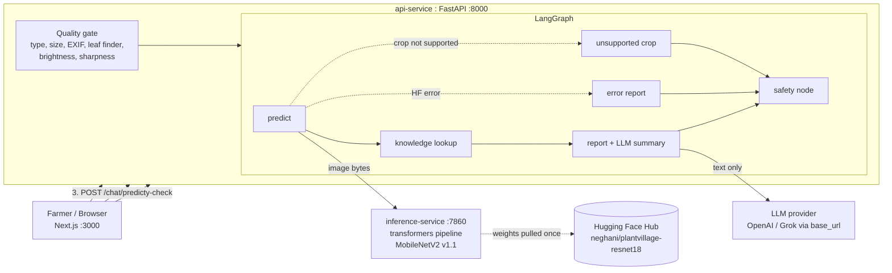

# Demo-Day Prep Guide: CropCare AI (Plant Disease Detection + Farmer Assistant)

Audience: you (Ganesh), preparing for the capstone demo in front of the Deep Learning / ML / Agentic AI trainers.

This guide does five things:

1. Gives an honest status snapshot (what is built, what the proposal promised but is not built yet).
2. Walks the whole journey a **fresher** would take, stage by stage, with the challenges they would hit and how this project solved each one.
3. Records every design **decision** (Kaggle vs Colab vs local, Hugging Face vs Kaggle for publishing, etc.) with the trade-offs.
4. Shows how to rebuild the core with **minimal AI help**, and how to run everything locally.
5. Gives you a demo script, a risk list, and ~40 likely trainer questions with answers.

Everything below is grounded in the repository as it stands today (code in `model/`, `api/`, `hf_space/`, `web/`, plus the published Hugging Face model card). Where something is a recommendation rather than a fact from the repo, it says so.

---

## 0. The 60-second pitch (memorise this)

> A farmer photographs a leaf. A **quality gate** first checks the photo (dark, blurry, tiny, no leaf?) and asks for a retake instead of guessing. A **MobileNetV2** that we fine-tuned on PlantVillage (38 classes, 14 crops) and then on Cropped-PlantDoc predicts the disease: 99.1% on the lab held-out split, **137/284 (48.2%)** on the one-shot field-style test. A **LangGraph** pipeline then looks the disease up in a curated knowledge base and an LLM writes a plain-language explanation. **The LLM never decides the disease and never sees the image**; it only rewrites what the classifier and knowledge base already say. Low confidence, wrong crop, or off-topic questions are handled explicitly. The live model is versioned on Hugging Face as tag **`v1.1`** (`shared/release.json`; `v1.0` is the PlantVillage-only baseline), served from a container, and the whole system runs with `docker compose up`.

If you can say that cleanly and then show it working, you have already covered the rubric.

---

## 1. Honest status snapshot (read this before anything else)

### 1.1 What is built and working

| Area | State | Evidence in repo |
|---|---|---|
| Training pipeline | Done | `model/train.py` (HF Trainer, augmentations, stratified split, seed, `splits.json`) |
| Evaluation | Done | `model/evaluate.py` (accuracy, macro-F1, top-3, confusion matrix, threshold sweep, model card) |
| Publishing | Done | `model/publish.py`, model live at `neghani/plantvillage-resnet18`, live tag `v1.1` (`v1.0` is the baseline) |
| Inference server | Done | `hf_space/app.py` (FastAPI + `transformers.pipeline`, stamps `x-model-id` / `x-model-revision`) |
| Quality gate | Done (leaf-aware) | `api/app/vision/quality.py`, `leaf.py` |
| Agent (LangGraph) | Done | `api/app/agent/graph.py` (predict, knowledge, report, safety, with 2 side exits) |
| Knowledge base | Done for all 38 classes | `api/data/knowledge/diseases.json` |
| API | Done | `api/app/main.py`: `/health`, `/quality-check`, `/predict`, `/chat` |
| UI | Done (Next.js, not Streamlit) | `web/` |
| Docker | Done | `docker-compose.yml` with 3 services |

Published numbers (from the Hugging Face model card, held-out PlantVillage test split, 5,430 images):

| Metric | Value |
|---|---|
| Accuracy | 99.12% |
| Macro precision / recall | 98.88% / 98.43% |
| Macro F1 | 98.58% |
| Top-3 accuracy | 99.94% |
| Split | train 43,445 / val 5,430 / test 5,430, seed 42 |

### 1.2 Gaps you must know about (trainers will find them if you don't say them first)

| # | Gap | Why it matters | What to do |
|---|---|---|---|
| 1 | **Real-world one-shot is 137/284 (48.2%), below the 50% goal.** Data is `model/data/real_world_set/`; report is `model/final_report.md`. | The proposal's headline success criterion is "at least 50% of real-world images correct, reported next to dataset results". | Quote 48.2% and the paired gain over `v1.0` (18.7%). Do not re-run `final_test.py` (guarded) or treat empty `model/data/real_world/` + `real_world_eval.py --revision v1.0` as the demo metric. |
| 2 | **99% is probably optimistic.** PlantVillage has many near-duplicate shots of the same leaf (different angle/rotation). A random per-image split puts siblings in train and test. | Trainers who know PlantVillage will ask about leakage. | Say it yourself: "99% is the in-distribution ceiling; the real-world number is the honest one." |
| 3 | **Hindi / regional language is not built.** The proposal promises glossary, mBERT summariser, IndicTrans, LLM expansion. README says "planned". | The coordinator said regional language contributes to full marks. | Build the cheap MVP in section 9.4 (glossary + LLM translate + back-translation check). |
| 4 | **Proposal vs implementation drift:** the proposal's Streamlit UI was replaced by Next.js in `web/` and the Streamlit app was removed; Grok became OpenAI-by-default (Grok still works via `LLM_BASE_URL=https://api.x.ai/v1`); the proposal says "two services", compose has three. | A trainer comparing proposal to demo will notice. | Have the one-line justification ready (section 8, decisions D12-D14). |
| 5 | **Quality gate exists in two versions that no longer match.** `model/common.py` uses whole-frame Laplacian variance (threshold 80). `api/app/vision/quality.py` uses a leaf-aware re-blur ratio. The README claims they match; they don't. | `real_world_eval.py` reports "quality gate rejections" using the *old* gate, so its count differs from what the live API does. | Either port the new gate into `model/common.py`, or say "the API gate is the source of truth". |
| 6 | **"Agentic" is a workflow, not an autonomous agent.** LangGraph runs a fixed graph with conditional exits; the LLM does not choose tools or loop. | The course is "agentic". | Own it as a deliberate safety choice (section 10, Q-A1). Optionally add one real agentic behaviour (section 9.3). |
| 7 | **Chat topic guard is a keyword list** (`AGRICULTURE_KEYWORDS` in `services/chat.py`). | Easy to bypass and gives false refusals ("how do I stop the bugs eating my cabbage?" has no keyword). | Mention the LLM system prompt is the second layer; propose a classifier/LLM-based guard as future work. |
| 8 | `quality.py` docstring cites `docs/challenges-and-approach.md`, which does not exist. | Dangling reference. | Section 5 of this guide can be copied there. |
| 9 | Knowledge base entries carry no source citations (in the entry inspected: description, symptoms, actions, monitoring, limitations, no URLs). | Proposal says "assembled from reliable agricultural sources". | Add a `sources` field per entry (ICAR / state agri university / extension pages) before demo. |
| 10 | Local Python test run failed in my check because dependencies were not installed in system Python (`ModuleNotFoundError`). | Not a project bug, but I could not confirm the suite is green. | Run `cd api && python -m venv .venv && source .venv/bin/activate && pip install -r requirements-dev.txt && PYTHONPATH=..:. pytest -q` before demo. |

Also: `.env` is git-ignored (good), but it holds your real LLM/HF keys. **Never open it on a shared screen.**

---

## 2. Architecture in one picture



Design rules worth stating out loud:

- **The image never goes to the LLM.** Vision decides; language explains.
- **Two-step UX.** `/quality-check` is cheap and local; `/predict` re-runs the gate server-side (never trust the client).
- **Provider independence.** One OpenAI-compatible client with `LLM_BASE_URL`; swap OpenAI/Grok by env var.
- **Pinned model revision.** Live pin is `shared/release.json` (`v1.1`). Env `HF_MODEL_REVISION` only overrides that file.
- **Fail soft.** Model down gives an "Analysis unavailable" report, LLM down gives template text from the knowledge base.

---

## 3. The fresher's journey: stage by stage

For each stage: what to do, what a fresher gets stuck on, how this project handled it, and what the fresher can do **without** AI.

### Stage 0: Frame the problem and choose a scope

| Question | Fresher mistake | Good answer |
|---|---|---|
| Classification, detection, or segmentation? | Reaching for YOLO because it sounds impressive | One leaf, one label = **image classification**. Simplest thing that meets the brief. |
| How many crops/classes? | Starting with all 38 | Start with **one crop (tomato, 10 classes)** to debug the pipeline in minutes, then scale. `train.py --crop_filter Tomato --max_samples_per_class 40` exists for exactly this. |
| What is "success"? | "High accuracy" | Write it down: accuracy + macro-F1 on held-out, **>= 50% on real-world images**, and a defined "not sure" behaviour. |
| What must the LLM *not* do? | Letting the LLM look at the photo and diagnose | Constrain it: it only explains a classifier output. This is the safety story. |

### Stage 1: Data (Kaggle)

PlantVillage (`abdallahalidev/plantvillage-dataset`): 54,305 `color` images, 38 classes, 14 crops, lab-style (single leaf, plain background).

| Challenge | Why it bites | How the project handles it |
|---|---|---|
| Finding/downloading the data | Kaggle auth, huge zips | `kagglehub.dataset_download(...)`, usually no credentials for public sets |
| Dataset has `color/`, `grayscale/`, `segmented/` | Training on the wrong folder, or all three | `common.resolve_data_dir` finds the `color` imagefolder |
| Ugly class names | `Pepper,_bell___Bacterial_spot`, `Corn_(maize)___Cercospora_leaf_spot Gray_leaf_spot` (comma, parentheses, space) break naive string handling | `crop_from_class` / `display_name` helpers, and the same strings are the keys of `diseases.json` |
| **Class imbalance** | Orange HLB has ~5.5k images, Potato healthy ~150 | Stratified split, **macro-F1** for model selection, per-class report |
| **Near-duplicate leakage** | Same leaf photographed at several angles ends up in both train and test, inflating accuracy | Not fixed (known limitation). Fix: cluster by perceptual hash or embedding similarity and split by cluster. |
| **Shortcut learning** | Lab background is constant; the net can learn the background, not the lesion. Published analyses of PlantVillage reported classifiers can predict well from background pixels alone. | Real-world test set + augmentations; be honest about it |
| Reproducibility | "It worked yesterday" | Fixed seed, `splits.json` with exact file lists, `run_info.json` with hyperparameters, all pushed to the Hub |

Fresher's no-AI path: read the dataset's Kaggle page, open 5 images per class by eye, plot the class counts bar chart (`os.listdir` + `matplotlib`). 30 minutes, and you will know your data better than any prompt could tell you.

### Stage 2: Where to train (Kaggle vs Colab vs local) and why

See decision D3 in section 8 for the full comparison. Short version for this project: **data from Kaggle, training on Colab (Colab Pro on a T4/L4, per the proposal annex), model published to Hugging Face, code on GitHub.**

Challenges a fresher meets in the cloud notebook:

| Challenge | Symptom | Project fix |
|---|---|---|
| Runtime disconnects | Lost 40 min of training | `--save_strategy epoch`, `--resume_from_checkpoint`, `--push_to_hub --hub_strategy end` |
| **Stale code in Colab** | You edit locally, re-upload, Colab runs the old file | `notebooks/colab_sync.py` hard-resets to `origin/main`; never `files.upload()` code |
| Real-world images are git-ignored | Lost after each runtime reset | One-time zip on Drive, always replaced by the sync script |
| Secrets | Token pasted into a cell and committed | Colab secret `HF_TOKEN` + `.env` locally (git-ignored); `get_hf_token()` searches env, `.env`, Colab secret, cached login |
| Library version drift | Code written for one `transformers` version breaks on the next | `_size_value()` in `train.py` handles int / dict / `SizeDict` shapes of `size`, a real scar from a version change |
| `set_transform` + Trainer | Columns silently dropped, "no pixel_values" | `training_args.remove_unused_columns = False` |
| fp16 on CPU/Mac | Crashes or no speedup | Use `--fp16` only on CUDA; `Predictor` auto-picks cuda / mps / cpu |
| Wrong HF account | Push fails with a 403 | `publish.py --check` verifies the token is **write** and the owner matches |

### Stage 3: Train the model (transfer learning)

What the project does (`model/train.py`, defaults in `model/README.md`):

| Choice | Value | Reason (and the honest caveat) |
|---|---|---|
| Base | `microsoft/resnet-18` (ImageNet pretrained) | Tiny (~9 MB), fast on CPU, matches the brief. |
| Head | New 38-way classifier (`ignore_mismatched_sizes=True`) | ImageNet's 1000-way head is dropped. |
| Fine-tuning | **Whole network** (not frozen) | Plant lesions differ from ImageNet textures; full fine-tune is fine with 43k images. |
| Optimiser/LR | HF Trainer default AdamW, `lr=5e-4`, cosine schedule, 5% warmup, weight decay 0.01 | Caveat: the repo records no LR sweep. Say "chosen from common practice, not tuned." |
| Epochs / batch | 5 epochs, batch 64, fp16 | ~8-10 min per epoch on a T4. |
| Model selection | Best checkpoint by **validation macro-F1** | Accuracy alone hides weak small classes. |
| Augmentation | RandomResizedCrop (70-100%), H/V flips, **rotation up to 180 deg**, ColorJitter, random Gaussian blur (p=0.25) | Simulates tilted/inverted/partial/dim/soft phone photos. |
| Eval preprocessing | Resize shortest edge, center-crop 224, normalise | Must equal the model's `preprocessor_config.json`. |

Challenges and what to know:

| Challenge | Explanation for a fresher | What to say in the demo |
|---|---|---|
| **Train/serve skew** | If training resizes one way and serving another, accuracy drops silently. | The API crops the leaf, pads to a square, resizes once to 256, then the model's processor does resize 256 to center-crop 224. That 256 is deliberately the processor's `shortest_edge`. |
| Overfitting | Train accuracy 100%, val lower | Validation split + `load_best_model_at_end` + augmentation |
| Why not freeze the backbone? | Faster, but lower ceiling | Two-stage (head-only warmup then unfreeze with a smaller LR) is a valid improvement |
| BatchNorm in tiny batches | BN statistics get noisy | Batch 64 is fine; below ~16 consider freezing BN |
| Loss/imbalance | Rare classes get ignored | Macro-F1 monitored; class-weighted loss or label smoothing are next steps |
| "Why 5 epochs?" | Fresher says "default" | The repo does not record why. Open `trainer_state.json` / the per-epoch validation macro-F1 from your Colab run and only claim "it plateaued" if the curve actually shows that. |

Fresher's no-AI path: follow the official Hugging Face **Image classification** task guide, then the PyTorch **Transfer Learning for Computer Vision** tutorial. A minimal from-scratch version is in section 6.2.

### Stage 4: Evaluate honestly

| Artifact | File | What it tells you |
|---|---|---|
| Accuracy, macro/weighted P/R/F1, top-3 | `reports/metrics.json` | Overall quality; top-3 99.94% means the right answer is almost always in the three shown |
| Per-class table | `classification_report.txt` | Weak classes |
| Confusion matrix | `confusion_matrix.png` | *Which* diseases get confused (Tomato early blight vs Septoria vs target spot, corn leaf spots) |
| Threshold sweep | `threshold_sweep.csv` | Coverage vs accuracy trade-off for "not sure" |

Weak spots visible in the published report (use them, don't hide them):

- `Potato___healthy` recall 73.3% but support is only **15** images: a tiny denominator, not necessarily a bad class.
- `Corn Cercospora/Gray leaf spot` precision 86%, `Tomato___Early_blight` precision 90%: confusion with look-alike classes.

**Confidence threshold (0.5).** The recommended threshold is chosen by rule: lowest threshold whose accuracy on covered images is >= 97% with coverage >= 50%. Caveat to volunteer: it was tuned on the *easy* PlantVillage test set. On real-world photos, softmax confidence is less trustworthy (softmax over 38 classes will always produce a confident-looking answer, even for a shoe). Re-run the sweep on the real-world set once you have it.

### Stage 5: The real-world gap and model refinement

This is where "model refinement" really lives. Ordered by effort vs impact (this ordering is my recommendation, not something the repo has done):

| # | Refinement | Effort | Expected effect | Notes |
|---|---|---|---|---|
| 1 | Build the real-world test set and **measure** | 0.5 day | Reveals the true gap | Must come first; nothing else is evidence-based without it |
| 2 | Leaf-crop before inference | Done | Removes background clutter | `leaf.py` colour mask, connected components, focus filter, square crop |
| 3 | Background-robust augmentation | 0.5 day | Reduces the shortcut-learning gap | Random erasing, background replacement, CutMix/MixUp |
| 4 | Add field images to training | 1-2 days | Largest realistic gain | Public field-style sets such as PlantDoc exist; mix a small share into train, **keep your real-world test set separate** |
| 5 | Two-stage fine-tuning + label smoothing | 0.5 day | Small, stable gain | Cheap to try |
| 6 | Calibrate confidence (temperature scaling) | 0.5 day | Makes "not sure" meaningful | Fit on a validation set that looks like the real world |
| 7 | Out-of-distribution handling ("this is not a leaf") | 1 day | Prevents confident nonsense | Add a "not a leaf/other" class, or use max-softmax/energy score; the quality gate's "no green found" partly covers this |
| 8 | Bigger backbone (the proposal's ResNet-50 fallback; EfficientNet/ConvNeXt-Tiny) | 0.5 day | Only if 1-7 are not enough | Supported with zero code change: `--model_name_or_path microsoft/resnet-50` |
| 9 | Test-time augmentation | 0.5 day | Small gain, slower inference | Average predictions over flips/rotations |
| 10 | Export to ONNX / int8 for speed | 1 day | Latency and size story | Stretch goal; benchmark before and after |

**Rule of thumb to teach a fresher:** *never refine without a number, and never evaluate refinements on data you trained on.*

### Stage 6: Image quality gate

The gate is a real engineering story, and the repo has the evidence (`leaf.py` docstring).

| Version | Method | Failure found |
|---|---|---|
| v0 (`model/common.py`) | Laplacian variance on whole frame at native resolution (reject if < 80) | Score depends on resolution (same photo ~40 at 1024 px, ~360 at 256 px) and on background; phone portrait mode blurs the background on purpose, so sharp big photos were rejected as "blurry" |
| v1 (`api/app/vision/`) | Find the leaf by colour (HSV vegetation mask), drop out-of-focus vegetation, cut thin bridges (grass), pick best leaf by size/sharpness/centrality, then measure sharpness **on the leaf only at a fixed scale** using a **re-blur ratio** plus an absolute-detail floor | Colour-based, so it can fail on very diseased/brown/yellow leaves; falls back to judging the whole frame when nothing green is found |

Other gate challenges, all handled in `quality.py`:

| Challenge | Handling |
|---|---|
| 48 MP phone photos exhaust memory | JPEG `draft` mode decodes at reduced size; work copy capped at 2048 px |
| Phone rotation stored in EXIF | `ImageOps.exif_transpose`; sizes swapped for orientations 5-8 |
| PNG/WebP with alpha, palette modes | Composite on white, convert to RGB |
| Decompression bombs | `MAX_PIXELS = 120M` guard |
| Wrong file type / empty / huge | `validate_upload` returns a specific message |
| Too dark / overexposed | Mean-brightness limits 35-230 |
| Leaf too small in frame | Coverage < 4% **and** < 128 px natively |
| Cannot trust client | `/predict` re-runs the gate server-side |
| Farmer-friendly messages | Every rejection says what to do ("Move closer", "Retake in better light") |

Interview-proof explanation of the re-blur ratio: *blur the leaf a little more and see how much fine detail disappears. A sharp leaf loses most of its high-frequency energy; an already-blurry leaf loses little. That ratio does not depend on resolution, and a floor on absolute detail catches heavy blur where only noise is left.*

Honest limitation: thresholds (`MIN_SHARPNESS_RATIO = 0.78`, `MIN_LAPLACIAN_VARIANCE = 25`) were calibrated by hand on a blur sweep and ~40 PlantVillage images (per the code comments), not on a labelled "good/bad photo" dataset. A better approach is to label ~100 phone photos good/bad and pick thresholds from the ROC curve.

### Stage 7: Publish the model (Hugging Face vs Kaggle vs GitHub)

See decision D4. What `publish.py` guards against:

| Fresher mistake | Guard |
|---|---|
| Read-only token | `verify_access` rejects `role == "read"` |
| Pushing to someone else's namespace | Owner/org check against `whoami()` |
| Uploading optimizer state and checkpoints (GBs) | `IGNORE` patterns (`checkpoint-*`, `optimizer.pt`, `scheduler.pt`, ...) |
| API silently changes after a retrain | Hub tags + live pin in `shared/release.json` (`v1.1`) |
| No documentation of what the model does | Model card generated from `model_card_template.md` with real metrics |
| Cannot reproduce | `splits.json`, `run_info.json` uploaded with the weights |
| "Why not use HF's free hosted inference?" | **It does not host custom fine-tunes** ("Model not supported by provider hf-inference", noted in `hf_space/README.md`), so we serve our own container |

Cheap safety commands: `python model/publish.py --check` then `--dry_run` then publish.

### Stage 8: Inference serving

| Option | Pros | Cons | Chosen? |
|---|---|---|---|
| HF serverless Inference API | Zero ops | Does not host this fine-tune | No |
| HF Inference Endpoint (dedicated) | Managed, autoscale | Paid | No (documented as alternative via `HF_ENDPOINT_URL`) |
| **HF Space (Docker) / local container** | Free CPU, same code locally and hosted | Cold starts, sleeps when idle | **Yes** (`hf_space/`) |
| Load model inside the API process | Simplest | Pulls torch into the API image; couples API and model lifecycles | No: the API image stays torch-free (numpy/scipy only) |
| ONNX Runtime | Faster, smaller | Extra conversion step | Stretch |

What a fresher trips on, and the project's answer:

| Challenge | Fix |
|---|---|
| Space cold start returns 503 | `classify_image` retries once after 2 s; warm the Space before demo |
| "Which model answered?" | Space stamps `x-model-id`/`x-model-revision`; API returns an `inference` block with `model_verified`, latency, input size |
| CPU torch is huge | `--extra-index-url https://download.pytorch.org/whl/cpu` in `hf_space/requirements.txt` |
| Container runs as root | Dockerfile creates a non-root user (HF Spaces requirement/best practice) |
| Is the endpoint alive? | `GET /health?probe=true` pings the inference server |
| Response shape varies (`[...]` vs `[[...]]`) | `_parse` normalises both |

### Stage 9: Agent and LLM

What the graph does (`api/app/agent/`):

```
predict -> (error?) predict_error --------\
        -> (crop not supported?) unsupported_crop --> safety --> END
        -> knowledge -> generate_report --/
```

| Node | Responsibility | Why it exists |
|---|---|---|
| `predict` | Calls the classifier, builds top-3, compares with farmer's crop hint | Crop mismatch/unsupported crop detection |
| `knowledge` | Dict lookup by class name | **Grounding**: no free-form LLM facts |
| `generate_report` | Builds a structured report from the knowledge entry, then asks the LLM for a 3-5 sentence summary | Structured fields stay deterministic; only the summary is generative |
| `safety` | Downgrades "confirmed" to "possible" under low confidence/mismatch; forces expert-confirmation flag; appends disclaimer; builds the chat session context | Central guardrail |
| error / unsupported-crop exits | Honest "can't help" reports | Avoids fabricating a disease for an unsupported plant |

LLM challenges for a fresher:

| Challenge | Handling |
|---|---|
| Hallucinated products/doses | System prompt forbids naming chemicals/doses; curated `actions` carry the real guidance |
| Off-topic chat | Keyword pre-filter plus system-prompt refusal (two layers) |
| No API key / quota / outage | `generate_text` returns `None` and the knowledge-base text is shown; chat has a fallback reply |
| LLM exceptions | Caught, returns `None` (note: it swallows errors silently, so log them in production) |
| Provider lock-in | OpenAI-compatible client with `base_url`; Grok = `https://api.x.ai/v1` |
| Image to LLM temptation | `generate_text` raises `TypeError` for non-str: "LLM accepts text only" |
| Stateless chat | Session context travels from the browser (sessionStorage) on each `/chat` call; no server DB |
| Prompt grounding | Prompt includes top-3, confidence level, curated description/actions/limitations, farmer notes |

### Stage 10: API and UI

| Challenge | Fix / explanation |
|---|---|
| Two-step flow | `/quality-check` (fast) then `/predict`; gate runs twice by design |
| Blocking CPU work in async FastAPI | `run_in_threadpool` for image analysis and graph invoke |
| Large uploads | 25 MB cap, type allow-list (JPEG/PNG/WebP) |
| **`NEXT_PUBLIC_*` is baked in at build time** | Compose passes `NEXT_PUBLIC_API_URL` as a **build arg**; changing `.env` later needs a rebuild |
| **Browser vs container networking** | Browser calls `http://localhost:8000`; API calls the model at `http://inference-service:7860/` (compose DNS). These are different "localhost"s. |
| CORS | Currently `allow_origins=["*"]` with credentials: fine for a demo, restrict it for production |
| Privacy/scope | No auth, no image storage, history only in browser sessionStorage |
| Typed contracts | Pydantic schemas on the API; TypeScript types in `web/src/lib/types.ts` |
| Fresher-friendly UI | Large upload card, guidelines card, short plain results, disclaimer banner |

### Stage 11: Package and run locally

See section 7 for the exact commands.

### Stage 12: Team and process challenges

| Challenge | Practice used here |
|---|---|
| Notebook vs scripts | Logic lives in `model/*.py`; the notebook only calls them (testable, diffable) |
| Phased ownership | Placeholder prediction in Phase 2, real model swapped in at Phase 5 behind a stable interface |
| Docs drifting from code | Visible in this repo (gate mismatch, missing challenges doc). Treat docs as code in review. |
| Secrets | `.env` git-ignored, `.env.example` committed |
| Claiming too much | Use "planned" markers (README does) and report real numbers |

---

## 4. Consolidated challenge catalogue (the "list them all" table)

| # | Stage | Challenge | Severity for a fresher | Solved in repo? |
|---|---|---|---|---|
| 1 | Scope | Picking too big a scope | High | Yes (`--crop_filter`, smoke test) |
| 2 | Data | Dataset folders (color/gray/segmented) | Medium | Yes |
| 3 | Data | Special characters in class names | Medium | Yes |
| 4 | Data | Class imbalance | High | Partly (macro-F1, stratified split; no class weights) |
| 5 | Data | Near-duplicate leakage | **High** | **No** |
| 6 | Data | Lab-background shortcut learning | **High** | Partly (augmentation, real-world test planned) |
| 7 | Env | Colab disconnects | High | Yes |
| 8 | Env | Stale files in Colab | High | Yes (`colab_sync.py`) |
| 9 | Env | Dependency version drift | Medium | Yes (`SizeDict` handling) |
| 10 | Env | Secrets handling | High | Yes |
| 11 | Train | Head replacement / mismatched sizes | Medium | Yes |
| 12 | Train | Overfitting, model selection | Medium | Yes (val split, macro-F1) |
| 13 | Train | LR / epochs not tuned | Medium | **No** (no sweep recorded) |
| 14 | Train | Train/serve preprocessing skew | **High** | Yes (256 then crop 224) |
| 15 | Eval | Accuracy misleading | High | Yes (macro-F1, per-class, confusion matrix) |
| 16 | Eval | Real-world gap | **Critical** | Yes — 137/284 (48.2%), below 50% |
| 17 | Eval | Softmax overconfidence / OOD inputs | High | Partly (threshold, crop hint, "no green" fallback) |
| 18 | Gate | Resolution-dependent blur metric | High | Yes (re-blur ratio) |
| 19 | Gate | Portrait-mode background blur | High | Yes (focus filter + leaf-only metric) |
| 20 | Gate | EXIF rotation / alpha / huge images | Medium | Yes |
| 21 | Gate | Hand-tuned thresholds | Medium | **No** (no labelled good/bad set) |
| 22 | Gate | Diseased (non-green) leaves fool colour mask | Medium | Partly (whole-frame fallback) |
| 23 | Publish | Token scope/owner errors | Medium | Yes (`publish.py --check`) |
| 24 | Publish | Huge checkpoint uploads | Medium | Yes (ignore patterns) |
| 25 | Publish | Version pinning | High | Yes (`shared/release.json` → `v1.1`) |
| 26 | Serve | HF serverless does not host fine-tunes | High | Yes (own Space/container) |
| 27 | Serve | Cold start 503 | Medium | Yes (retry) |
| 28 | Serve | Provenance of predictions | Low | Yes (headers + `inference` block) |
| 29 | Agent | Hallucinated treatments | High | Yes (curated KB + prompt rules) |
| 30 | Agent | Off-topic questions | Medium | Partly (keywords + prompt) |
| 31 | Agent | LLM unavailable | Medium | Yes (fallback text) |
| 32 | Agent | Wrong crop / unsupported crop | High | Yes (crop hint logic) |
| 33 | Agent | KB source citations | Medium | **No** |
| 34 | API/UI | Build-time env var in Next.js | **High** | Yes (build arg) |
| 35 | API/UI | Container vs browser networking | High | Yes |
| 36 | API/UI | CORS wide open | Low (demo) | **No** (by design for demo) |
| 37 | Product | Hindi/regional language | High (marks) | **No** |
| 38 | Process | Docs drift | Medium | **No** |

Bold "No" rows are your honest-limitations slide.

---

## 5. Challenges and approach (ready to paste as `docs/challenges-and-approach.md`)

The `quality.py` docstring references this file. A short version for the repo:

1. **Phone photos are big and rotated.** Decode once with JPEG draft mode, apply EXIF orientation, cap the working size at 2048 px.
2. **Blur metrics lie.** A raw Laplacian variance depends on resolution and background. Use a leaf-only, fixed-scale re-blur ratio with an absolute-detail floor.
3. **Backgrounds confuse a lab-trained model.** Locate the leaf, crop to a padded square, resize once to the size the model expects.
4. **Softmax is always confident.** Use a threshold from the sweep, show top-3, cross-check the farmer's crop, and downgrade to "possible match" with an expert-confirmation flag.
5. **LLMs invent things.** Ground on a curated knowledge base, forbid chemical names/doses, send text only.
6. **Hosted inference does not host custom fine-tunes.** Serve the pinned Hub revision from our own container.

---

## 6. Doing it with minimal AI help

### 6.1 The rule: AI as tutor and reviewer, not author

| Do yourself (this is the learning) | Fine to ask AI |
|---|---|
| Write the data loader and the training loop skeleton from an official tutorial | Review your code for bugs; explain an error trace |
| Pick metrics and explain them | Suggest edge cases you forgot |
| Decide thresholds from your own plots | Generate boilerplate (Dockerfile, CORS, Pydantic models) |
| Write the prompts and read the LLM outputs critically | Draft docs; you then correct them against the code |
| Collect and label real-world images | Format/clean CSVs |

Self-test before demo: with no AI and no notes, can you (a) draw the architecture, (b) explain why macro-F1, (c) explain the re-blur ratio, (d) explain why the LLM never sees the image, (e) trace one request through the code? If not, study that part.

### 6.2 Minimal training script (~40 lines, PyTorch only)

A fresher can write this from the PyTorch transfer-learning tutorial. I have not run it against your data; treat it as a starting skeleton. It uses a naive random split, which is exactly the leakage trap from Stage 1.

```python
import torch, torch.nn as nn
from torch.utils.data import DataLoader, random_split
from torchvision import datasets, models, transforms as T

DATA = "path/to/plantvillage/color"          # imagefolder: <class>/
dev = "cuda" if torch.cuda.is_available() else ("mps" if torch.backends.mps.is_available() else "cpu")

norm = T.Normalize([0.485, 0.456, 0.406], [0.229, 0.224, 0.225])
train_tf = T.Compose([T.RandomResizedCrop(224, scale=(0.7, 1.0)), T.RandomHorizontalFlip(),
                      T.RandomVerticalFlip(), T.RandomRotation(180), T.ColorJitter(0.4, 0.3, 0.3),
                      T.ToTensor(), norm])
eval_tf = T.Compose([T.Resize(256), T.CenterCrop(224), T.ToTensor(), norm])

full = datasets.ImageFolder(DATA, transform=train_tf)
n = len(full); n_val = n_test = int(0.1 * n)
train_ds, val_ds, test_ds = random_split(full, [n - n_val - n_test, n_val, n_test],
                                         generator=torch.Generator().manual_seed(42))
# NOTE: val/test above still use train_tf (augmented). For honest eval, build a second
# ImageFolder with eval_tf and index it with val_ds.indices / test_ds.indices.

model = models.resnet18(weights=models.ResNet18_Weights.IMAGENET1K_V1)
model.classifier[1] = nn.Linear(model.last_channel, len(full.classes))
model.to(dev)

opt = torch.optim.AdamW(model.parameters(), lr=5e-4, weight_decay=0.01)
loss_fn = nn.CrossEntropyLoss()
loader = DataLoader(train_ds, batch_size=64, shuffle=True, num_workers=2)

for epoch in range(3):
    model.train()
    for x, y in loader:
        x, y = x.to(dev), y.to(dev)
        opt.zero_grad(); loss = loss_fn(model(x), y); loss.backward(); opt.step()
    print("epoch", epoch, "last batch loss", float(loss))
torch.save({"state": model.state_dict(), "classes": full.classes}, "mnv2.pt")
```

The deliberate gaps (fix each yourself, that is the exercise): honest eval transforms, a validation loop, macro-F1 via `sklearn.metrics.f1_score`, LR schedule, checkpointing.

### 6.3 Minimal quality gate (brightness + sharpness, whole frame)

```python
import numpy as np
from PIL import Image, ImageOps

def check(path):
    img = ImageOps.exif_transpose(Image.open(path)).convert("L")
    img.thumbnail((256, 256))                       # fixed scale, removes resolution dependence
    g = np.asarray(img, dtype=np.float32)
    lap = (-4*g[1:-1,1:-1] + g[:-2,1:-1] + g[2:,1:-1] + g[1:-1,:-2] + g[1:-1,2:])
    if g.mean() < 35:  return "too dark"
    if g.mean() > 230: return "overexposed"
    if lap.var() < 25: return "blurry"
    return "ok"
```

This is already better than the project's v0 because of the fixed-scale thumbnail. The next step (leaf-only measurement) is what `leaf.py` adds.

### 6.4 Minimal serving + agent skeleton

```python
from fastapi import FastAPI, File, UploadFile
from transformers import pipeline
from PIL import Image
import io, json

clf = pipeline("image-classification", model="neghani/plantvillage-resnet18", revision="v1.1")
KB = json.load(open("api/data/knowledge/diseases.json"))
app = FastAPI()

@app.post("/predict")
async def predict(file: UploadFile = File(...)):
    img = Image.open(io.BytesIO(await file.read())).convert("RGB")
    top = clf(img, top_k=3)
    best = top[0]
    if best["score"] < 0.5:
        return {"status": "not_sure", "top3": top}
    return {"status": "ok", "label": best["label"], "score": best["score"],
            "guidance": KB.get(best["label"]), "top3": top}
```

Then add the LLM as a *separate* function that takes only text. That is your whole project in ~20 lines; everything else in the repo is robustness.

### 6.5 Real-world images (already collected)

The one-shot set is `model/data/real_world_set/` (`labels.csv` + `images/`). Quote **137/284 (48.2%)** from `model/final_report.md`. Do not treat empty `model/data/real_world/` or `real_world_eval.py --revision v1.0` as the demo metric, and do not re-run `final_test.py` for `v1.1` unless `--force`.

### 6.6 A realistic fresher timeline (my estimate, not from the repo)

| Week | Focus | Output |
|---|---|---|
| 1 | Python/PyTorch basics, read data, tomato-only smoke train | First confusion matrix |
| 2 | Full 38-class train in Colab, evaluate, publish to HF | Model card with numbers |
| 3 | Real-world set + quality gate + FastAPI endpoint | Honest gap measurement |
| 4 | LangGraph flow + knowledge base + LLM guardrails | End-to-end CLI/API demo |
| 5 | UI + Docker + docs + rehearsal | Demo |

With heavy AI help your team compressed this into roughly a day of commits (git history is dated 11 Oct, 12:22 to 16:00). Trainers may ask which parts you understand deeply, so use section 10 and the self-test above.

---

## 7. Run everything locally (no GPU needed for the demo)

Training needs a GPU; **inference and the demo do not.** MobileNetV2 runs on CPU.

### 7.1 One-time setup

```bash
cp .env.example .env            # LLM_API_KEY optional; without it you get knowledge-base text
```

### 7.2 Option A: Docker (what you demo)

```bash
docker compose up --build
# UI  http://localhost:3000/check
# API http://localhost:8000/docs   and   /health?probe=true
```

First start downloads the model from the Hub into the container; give it a minute. After `/health?probe=true` shows `hf_reachable: true`, you are ready.

### 7.3 Option B: three terminals (best for debugging)

```bash
# 1) model server
cd hf_space && python -m venv .venv && source .venv/bin/activate
pip install -r requirements.txt && uvicorn app:app --port 7860

# 2) API
cd api && python -m venv .venv && source .venv/bin/activate && pip install -r requirements.txt
HF_ENDPOINT_URL=http://localhost:7860/ PYTHONPATH=. uvicorn app.main:app --reload --port 8000

# 3) UI
cd web && npm install && NEXT_PUBLIC_API_URL=http://localhost:8000 npm run dev
```

### 7.4 Training locally (smoke test only)

```bash
pip install -r model/requirements.txt
python - <<'EOF'
import kagglehub; print(kagglehub.dataset_download("abdallahalidev/plantvillage-dataset"))
EOF
export DATA_DIR=<printed path>
python model/train.py --data_dir "$DATA_DIR" --crop_filter Tomato --max_samples_per_class 40 \
  --output_dir model/outputs/smoke --do_train --do_eval --num_train_epochs 1 \
  --per_device_train_batch_size 16 --learning_rate 5e-4 --report_to none --save_strategy no
python model/evaluate.py --model model/outputs/smoke
python model/predict.py some_leaf.jpg --model model/outputs/smoke --revision main
```

### 7.5 Offline / bad-Wi-Fi insurance (my recommendation, test before relying on it)

- Run the stack once online so the model is cached, then set `HF_HUB_OFFLINE=1` for the inference service. In Docker the cache lives in the container; mount a volume for `~/.cache/huggingface` so a rebuild does not lose it.
- The LLM needs internet. Without `LLM_API_KEY`, the app falls back to knowledge-base text. Decide which version you demo and **rehearse that exact one**.
- Record a 2-minute screen video of a successful run as the last-resort backup.

---

## 8. Decision log (the "why" behind every choice)

| ID | Decision | Options considered | Chosen | Why | Trade-off to admit |
|---|---|---|---|---|---|
| D1 | Task type | Classification / detection / segmentation / VLM | Classification | One leaf, one label; brief prefers MobileNetV2 | Cannot localise multiple lesions or multiple leaves |
| D2 | Dataset | PlantVillage / PlantDoc / own photos | PlantVillage (+ internet real-world test set) | Coordinator-recommended, large, labelled | Lab-style bias, near-duplicates |
| D3 | **Where to get data, where to train** | Local / **Kaggle notebooks** / **Colab** / HF Jobs | **Dataset from Kaggle (`kagglehub`), train on Colab (Pro)**, scripts in the repo | See table below | Colab sessions can disconnect; mitigated with checkpoints and push-to-hub |
| D4 | **Where to publish** | GitHub / **Kaggle Models** / **HF Hub** | **Code on GitHub, model on HF Hub**, dataset stays on Kaggle | See table below | Model lives off GitHub; need a token |
| D5 | Base model | MobileNetV2 / ResNet-50 / EfficientNet / ViT | MobileNetV2 (ResNet-50 fallback wired in) | Small, CPU-friendly, in the brief | Lower ceiling than bigger nets |
| D6 | Training framework | Raw PyTorch / HF Trainer / Keras | HF `Trainer` | Checkpointing, fp16, push-to-hub, metrics for free | Less transparent for a beginner (hence 6.2) |
| D7 | Fine-tune depth | Head only / full | Full | Enough data, domain differs from ImageNet | Slightly more overfit risk |
| D8 | Selection metric | Accuracy / macro-F1 | Macro-F1 | Imbalance | Per-class support can be tiny |
| D9 | Confidence handling | Always answer / threshold | Threshold 0.5 + top-3 + "possible match" | Honesty about uncertainty | Threshold tuned on easy data |
| D10 | Quality gate | None / simple blur / leaf-aware | Leaf-aware, server-side | Simple gate rejected good photos | Hand-tuned thresholds |
| D11 | Inference hosting | Serverless / Endpoint / own Space | Own Space/container | Serverless does not host custom fine-tunes | Cold starts |
| D12 | UI | Streamlit (proposal) / Next.js | Next.js + Tailwind | Closer to the Figma design, richer UX | Differs from proposal; adds Node to the stack |
| D13 | LLM provider | Grok / OpenAI / others | OpenAI-compatible client, default OpenAI, Grok via `LLM_BASE_URL` | Provider independence, quota | Proposal said "Grok first" |
| D14 | Agent framework | LangGraph / Pydantic AI / Chainlit | LangGraph | Explicit steps and conditional exits | Workflow, not autonomous |
| D15 | LLM role | Diagnoses / explains | **Explains only** | Safety and reproducibility | Cannot use visual cues the classifier missed |
| D16 | Knowledge source | LLM memory / curated JSON / RAG over docs | Curated JSON (38 entries) | Deterministic, auditable | No citations yet; not scalable |
| D17 | State | Server DB / client storage | Client `sessionStorage` | No auth/PII needed for demo | History lost on tab close |
| D18 | Packaging | Compose / single container | Compose (3 services) | Separation, same on laptop and server | Some free hosts allow one container only |
| D19 | Versioning | `main` / tags | Live pin `shared/release.json` (`v1.1`; `v1.0` is baseline) | Reproducible API behaviour | Must remember to bump |

### D3 in detail: Kaggle vs Colab vs local (training environment)

| Factor | Kaggle Notebooks | Google Colab | Local laptop |
|---|---|---|---|
| Dataset access | Native: attach the dataset, no download | `kagglehub` download each fresh runtime (~GBs) | Download once |
| Free GPU | Weekly quota (roughly 30 h) with long sessions; verify current limits | Variable, can be pre-empted on free tier; **Pro gives T4/L4 and longer runs (Ganesh has Pro)** | None (CPU/MPS only) |
| Session persistence | Versioned notebook runs, outputs saved | Disk wiped on reset; use Drive/Hub | Persistent |
| Secrets | Kaggle Secrets | Colab Secrets | `.env` |
| Collaboration | Share notebook/dataset | Share notebook; Drive | Git |
| Fit for this team | Great fallback | **Primary (Pro already available, proposal specifies Colab, graders asked for a Colab notebook)** | Smoke tests and demo only |

Say: "We took the data from Kaggle, trained on Colab because the coordinator asked for a Colab notebook and we had Pro, and kept Kaggle notebooks as a backup GPU."

### D4 in detail: where to publish

| Target | Good for | Why/why not here |
|---|---|---|
| **GitHub** | Code, docs, notebooks | Yes; weights do not belong in Git |
| **Hugging Face Hub** | Weights + model card + versioning via tags, `from_pretrained(..., revision="v1.0")`, Spaces for hosting | **Yes**: the same ecosystem as `transformers`, free hosting via Spaces, model card with metrics, tag pinning |
| **Kaggle Models / Datasets** | Discoverability in Kaggle community, competition workflows | Optional extra (publish the notebook or model for visibility), but not needed for serving; Kaggle has no equivalent of Spaces/`revision` pinning for our loader |

If a trainer asks "why not publish to Kaggle?": "Kaggle is where our data came from. For deployment we needed versioned weights loadable by one line in `transformers` and a free container host, which is the Hub plus Spaces. We could additionally mirror the model to Kaggle Models for visibility."

---

## 9. Optional upgrades, ranked by demo impact per hour

### 9.1 Must-do before demo (about 1 day total)

1. Real-world evaluation with 40-60 images and a pushed report (6.5).
2. Warm the Space/containers, run through the checklist in `docs/phase2-demo-checklist.md`.
3. Backend venv + `pytest` run to confirm green.
4. Prepare a fixed set of demo images (see 11.2).
5. Screen-record a backup run.

### 9.2 Should-do (about 1 day)

- Port the leaf-aware gate to `model/common.py` (or state the API is the source of truth).
- Add `sources` to each KB entry.
- Re-run the threshold sweep on the real-world set; if the best threshold differs, say so.
- Fill `docs/challenges-and-approach.md` from section 5.

### 9.3 Make the "agentic" claim stronger (about half a day each, pick one)

- **Retake loop:** if the gate fails or confidence is low, the agent proposes *specific* next steps and the UI offers "upload another angle"; combine top-1 predictions across 2-3 photos.
- **Tool-calling chat:** give the chat LLM two tools, `lookup_disease(id)` (KB) and `get_prediction()` (session), so it retrieves facts instead of receiving them pasted into the prompt. This is a genuine ReAct-style agent and a good talking point.
- **Evaluator node:** a second LLM call checks the summary against the KB entry ("does the summary add any claim not in the reference?") and regenerates if it fails.

### 9.4 Hindi MVP (about 1 day; honest and cheap)

1. `api/data/glossary_en_hi.json` with ~60 key terms (blight, rust, fungicide, lesion, mildew, ...).
2. Translate the **final English report** with the LLM, injecting the glossary into the prompt and requiring those exact terms.
3. Check quality: back-translate to English and compare key terms/embedding similarity (a script, report the numbers).
4. UI: a language toggle plus a dict of ~30 UI strings.
5. Say clearly that the proposal's IndicTrans/mBERT pipeline is the heavier follow-up (large models, needs GPU or a hosted API).

---

## 10. Trainer Q&A (rehearse these)

### Deep learning and ML

**Q1. Why MobileNetV2?**
Small (~9 MB), fast on CPU, depthwise-separable convolutions keep compute low, and it was the brief's preference. Our container serves it on CPU. ResNet-50 is wired as a fallback with one flag.

**Q2. What is transfer learning and why use it?**
We start from ImageNet weights (edges, textures, shapes), replace the final layer with a 38-way head, and fine-tune. With 43k images this converges in a few epochs and generalises better than training from scratch.

**Q3. Did you freeze layers?**
No, full fine-tune. Option: head-only warmup then unfreeze with a lower LR. Not tried; it is a reasonable next experiment.

**Q4. Why macro-F1 and not accuracy?**
Classes are imbalanced (about 150 to 5,500 images). Accuracy is dominated by big classes. Macro-F1 weights each class equally.

**Q5. 99% sounds too good. Is it?**
It is real on this split but optimistic: PlantVillage has near-duplicate shots of the same leaf and a uniform background, so random splits leak and the model can partly rely on background. That is why we evaluate on real-world images and report the gap.

**Q6. What is in your augmentation and why?**
Random resized crop, flips, rotation up to 180 degrees, colour jitter and random blur to imitate tilted, inverted, partially framed, dim and soft phone photos.

**Q7. Explain the confusion matrix. What gets confused?**
Rows true, columns predicted. Look-alike foliar diseases: tomato early blight vs Septoria vs target spot; corn leaf spots/northern blight. Potato healthy shows 73% recall but only 15 test images.

**Q8. What is top-3 accuracy and why show it?**
Right answer is within the three highest scores: 99.94%. We show top-3 to the farmer and the LLM so ambiguity is visible rather than hidden.

**Q9. What learning rate and why?**
5e-4 AdamW with cosine decay and 5% warmup, a common choice for fine-tuning a small convnet with a fresh head. We did not run a sweep; I would try 1e-4 to 1e-3 next.

**Q10. What is softmax and why is it overconfident?**
Softmax normalises logits to sum to 1; it always picks something. It does not model "none of the above", so out-of-distribution inputs still get a confident class. Mitigations: threshold, top-3, crop hint check, quality gate, and (future) calibration/OOD scoring.

**Q11. How did you pick the 0.5 threshold?**
Sweep from 0.50 to 0.95; choose the lowest threshold where accuracy on accepted predictions >= 97% with coverage >= 50%. At 0.5, coverage 99.85% and accuracy on covered 99.21%. It was tuned on in-distribution data, so I would re-tune on real-world images.

**Q12. How do you prevent training/serving skew?**
Same processor config for eval and serving: resize shortest edge 256, center crop 224, ImageNet mean/std. The API resizes the leaf crop to exactly 256 so the processor does a clean crop.

**Q13. What would you do to improve real-world accuracy?**
Measure first; then background-robust augmentation, add field-style images to training (keeping a separate test set), two-stage fine-tuning, calibration, and only then a bigger backbone.

**Q14. Why not object detection or segmentation?**
Not needed for a single-leaf label, and labelling boxes/masks is expensive. We do a cheap colour-based leaf localisation only for cropping and quality checks.

**Q15. Why a stratified split with a seed?**
Every class appears in train/val/test in the same proportion, and `splits.json` makes the experiment reproducible.

### Image quality gate

**Q16. How do you detect blur?**
Laplacian variance measures edge energy. Raw variance depends on resolution and background, so we localise the leaf, normalise scale, and use a re-blur ratio plus an absolute-detail floor.

**Q17. How do you find the leaf without a neural network?**
HSV vegetation mask, remove out-of-focus vegetation, cut thin bridges with erosion/distance transform, label connected components, rank by sharpness, size and centrality. Millisecond-fast and keeps the API image torch-free. A CNN detector can replace it behind the same function.

**Q18. What fails?**
Heavily diseased brown/yellow leaves can fool the colour mask (we fall back to judging the whole frame), and thresholds are hand-calibrated rather than learned.

**Q19. Why run the gate twice?**
The client check is for fast feedback; the server re-check is for correctness since clients cannot be trusted.

### MLOps and publishing

**Q20. Why Hugging Face and not Kaggle for publishing?**
See D4. Versioned weights via tags, one-line loading, Spaces for free container hosting, model card with metrics. Kaggle supplied the data.

**Q21. How do you version and reproduce?**
Seed, `splits.json`, `run_info.json`, model card with metrics, Hub tags `v1.0` (baseline) and `v1.1` (live), and the API reads `shared/release.json`.

**Q22. Why not use Hugging Face serverless inference?**
It reported "Model not supported by provider hf-inference" for custom fine-tunes, so we serve the same weights from our own container.

**Q23. How do you handle secrets?**
`.env` is git-ignored; `.env.example` is committed; Colab uses secrets; `publish.py --check` verifies the token has write scope.

**Q24. How did you avoid Colab's stale-code problem?**
`colab_sync.py` hard-resets the clone to `origin/main`; we never upload code files.

### Agentic / LLM

**Q-A1. Is this really agentic?**
Honest answer: it is an *orchestrated agent workflow* with conditional routing (error, unsupported crop, low confidence), deterministic tools (classifier, knowledge lookup) and one generative step. We deliberately did not let the LLM choose actions, because in a medical-advice-like domain predictability and auditability beat autonomy. The next step toward more autonomy would be tool-calling chat (9.3).

**Q-A2. Why LangGraph?**
Explicit nodes and edges match our pipeline, conditional exits are first-class, and state is typed (`DiagnosisState`).

**Q-A3. How do you stop hallucination?**
(1) LLM never diagnoses, (2) grounded in a curated entry per class, (3) prompt forbids chemical names and doses, (4) low confidence leads to "possible match" and expert confirmation, (5) a fixed disclaimer, (6) fallback to template text.

**Q-A4. How do you keep chat on-topic?**
Keyword pre-filter plus a system prompt that declines non-agriculture questions in one sentence. The keyword layer is brittle; a classifier/LLM guard is future work.

**Q-A5. Why does the LLM never see the image?**
Separation of concerns and safety: the specialised model decides, the language model explains. It also avoids vision-LLM hallucination and cost, and `generate_text` enforces text-only.

**Q-A6. How is the LLM swappable?**
One OpenAI-compatible client; provider changes via `LLM_MODEL` and `LLM_BASE_URL` (Grok: `https://api.x.ai/v1`).

**Q-A7. What if the LLM is down?**
Structured fields come from the knowledge base, `initial_message` falls back to a composed template, chat returns a fallback reply.

**Q-A8. Where is memory/state?**
The browser keeps the session context and sends it on each `/chat` call. The server is stateless, so it scales and stores no personal data.

**Q-A9. How do you evaluate the LLM output?**
Test cases against the knowledge base, and (if you add it) an evaluator node. Be honest if you have not run a formal evaluation yet.

**Q-A10. How would you add RAG?**
Replace the dict lookup with embeddings over extension documents (chunk, embed, retrieve top-k by disease + question) and cite sources. Currently the corpus is small enough for exact lookup.

### System design

**Q25. Why separate inference-service from the API?**
Keeps torch (~hundreds of MB) out of the API image, scales independently, and lets the model be hosted anywhere via `HF_ENDPOINT_URL`.

**Q26. What if the model server is down?**
Graph routes to an error node and the user gets "Analysis unavailable"; the API does not crash.

**Q27. How would you scale this?**
Stateless API behind a load balancer, model server replicas, request queue for spikes, GPU or ONNX/int8 for cost, CDN for the UI.

**Q28. Security/privacy?**
No auth and no image storage in the demo (explicitly out of scope). Production: restrict CORS, rate-limit, authenticate, scan uploads, set retention policy.

**Q29. What are the main risks of wrong advice?**
Misdiagnosis leading to unnecessary spraying. Mitigations: expert-confirmation flags, disclaimer, no doses/products, top-3 shown.

**Q30. How do you test?**
Pytest suite with a fake classifier and fake LLM (`api/tests/test_api.py`): gate blocks before model call, healthy/low-confidence paths, HF failure path, text-only LLM prompt. Model quality is tested separately by `evaluate.py` and `real_world_eval.py`.

### Process and honesty questions

**Q31. How much of this did AI write?**
Be truthful: say which parts you can explain line by line, and that you used AI as an accelerator and reviewer. Use the self-test in 6.1; trainers value honesty plus understanding over a polished lie.

**Q32. What is the biggest weakness?**
Real-world generalisation of a lab-trained model, and a keyword-based topic guard. Both are measured/known and have a concrete next step.

**Q33. What did you change from the proposal and why?**
Next.js instead of Streamlit (closer to Figma), OpenAI-compatible client with Grok configurable, a leaf-aware gate (the simple one rejected good photos), a unified `/quality-check` + `/predict` flow. Hindi pipeline is a follow-up (or MVP per 9.4).

**Q34. What would you do with two more weeks?**
Fix leakage with cluster-based splits, field data fine-tuning, calibration/OOD, source-cited RAG, Hindi with glossary evaluation, learned quality-gate thresholds.

**Q35. Which numbers should I trust?**
Test accuracy/F1 for in-distribution; the real-world top-1/top-3 for deployment reality; the threshold sweep for how often the system says "not sure".

---

## 11. Demo day

### 11.1 Timeline (8-10 minutes)

| Min | What | Say |
|---|---|---|
| 0:00-1:00 | Problem + pitch (section 0) | Farmers need quick, safe, understandable guidance |
| 1:00-2:30 | Architecture slide (section 2) | "Vision decides, language explains" |
| 2:30-4:00 | Model slide: data, MobileNetV2, 99.1% / 98.6% F1, confusion matrix, **real-world result** | Show the honest gap and the plan |
| 4:00-5:00 | Quality gate slide + one rejection live | Why the old gate failed and how the new one works |
| 5:00-7:30 | **Live demo** (11.2) | |
| 7:30-8:30 | Challenges and decisions (sections 3 and 8, top 5) | Kaggle data, Colab training, HF publishing, own container |
| 8:30-9:30 | Limitations and next steps | Own the gaps before they are found |
| 9:30+ | Q&A | Section 10 |

### 11.2 Live demo script (prepare files beforehand, in a folder named `demo_images/`)

| Step | Input | Expected | Teaches |
|---|---|---|---|
| 1 | Open `/health?probe=true` in a tab | `hf_reachable: true`, `v1.1` | The model is pinned and live |
| 2 | Clear tomato early/late blight leaf | Diagnosis, top-3, actions, monitoring | Core flow |
| 3 | Healthy leaf | "Looks healthy", no expert warning | Positive class |
| 4 | Dark or blurred photo | Retake message, **no model call** | Quality gate |
| 5 | Same leaf with crop hint "Hibiscus" | "Crop not supported" | Honesty about scope |
| 6 | Same tomato leaf with crop hint "Potato" | "Possible match" + mismatch note | Safety node |
| 7 | One real-world photo (ideally a failure) | Low confidence or wrong answer, explained | Transparency |
| 8 | Chat: "Should I remove lower leaves?" | Contextual answer | Grounded chat |
| 9 | Chat: "Who won the cricket match?" | Polite one-line decline | Topic guard |
| 10 | Open `/docs` | Auto-generated API docs | Deliverable: API documentation |

### 11.3 Risk register for the day

| Risk | Mitigation |
|---|---|
| Space cold start / network | Warm 10 min before; local compose as plan B; recorded video as plan C |
| LLM quota or outage | Know that the template fallback works; keep a spare key; decide beforehand which mode you show |
| Wrong answer on live image | Pre-test every demo image; explain top-3 and the threshold if it happens |
| Wi-Fi | Hotspot ready, offline model cache (7.5) |
| Browser cached an old build (Next.js env vars baked in) | `docker compose up --build`, hard refresh |
| Accidentally showing `.env` or tokens | Close the file, use a clean terminal profile |
| Laptop sleeping or low battery | Plug in, disable sleep |

### 11.4 Pre-demo checklist

- [ ] Real-world evaluation done; numbers on a slide
- [ ] `pytest` green in a venv
- [ ] `docker compose up --build` from a clean state works
- [ ] `/health?probe=true` shows model `neghani/plantvillage-resnet18@v1.1`
- [ ] All demo images tested; backup video recorded
- [ ] Slides include: pitch, architecture, data, model, confusion matrix, real-world result, gate, agent, decisions, limitations, next steps
- [ ] You can answer the self-test in 6.1 without notes
- [ ] Hindi MVP either demoable or clearly labelled "planned"
- [ ] Repo shared with the coordinator; README matches reality (update the gate-threshold claim)

---

## 12. Glossary (quick definitions for your own revision)

| Term | One line |
|---|---|
| Transfer learning | Reuse a network trained on a large dataset and adapt it to a new task |
| Fine-tuning | Continue training pretrained weights on your data |
| Macro-F1 | Average of per-class F1, so small classes count equally |
| Confusion matrix | Table of true vs predicted classes |
| Top-k accuracy | Correct if the true class is among the k highest scores |
| Softmax | Turns logits into probabilities that sum to 1 |
| Calibration | Making predicted confidence match actual accuracy |
| OOD | Out-of-distribution: inputs unlike the training data |
| Laplacian variance | Edge-energy measure used for blur detection |
| EXIF orientation | Metadata that tells viewers how to rotate a photo |
| Model card | README describing a model, data, metrics, limits |
| Revision/tag (HF) | Immutable pointer to a model version |
| LangGraph | Library for building stateful LLM workflows as graphs |
| Grounding | Constraining LLM output to supplied facts |
| RAG | Retrieve relevant documents, then generate an answer from them |
| ReAct / tool calling | LLM decides to call tools and uses results to answer |

---

*Sources of truth used for this guide:* `model/*`, `hf_space/*`, `api/app/*`, `api/tests/*`, `web/src/*`, `docker-compose.yml`, `docs/Plant_Disease_Detection_Proposal_v1.docx`, `docs/phase2-demo-checklist.md`, and the published model card at `huggingface.co/neghani/plantvillage-resnet18` (fetched on the day of writing). Items labelled "my recommendation" or "my estimate" are not from the repo.
