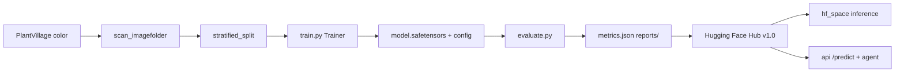

# Plant leaf disease model (Phase 1)

Fine-tuned **ResNet-18** on the **PlantVillage** dataset for 38 crop-disease classes. The release
used in the API and Hugging Face Space is published at:

**https://huggingface.co/neghani/plantvillage-resnet18** — live tag is **`shared/release.json`** (`hf_model_revision`)

Plant disease classification is fine-grained: early vs late blight can differ in subtle texture (spot
edges, concentric rings) with noisy backgrounds. ResNet-18 preserves more of that structure than
depthwise-separable MobileNetV2, which can over-smooth fine detail when optimizing for speed.

| | |
|---|---|
| **Owners** | Ganesh, Shravanya (proposal Annex A) |
| **Hub account** | `neghani` |
| **Project** | IIIT-H Group 4 — AI-powered plant disease detection and farmer assistance |

---

## Model at a glance

| Item | Value |
|---|---|
| **Architecture** | [`microsoft/resnet-18`](https://huggingface.co/microsoft/resnet-18) |
| **Task** | Multi-class image classification (RGB leaf photos) |
| **Output** | One of 38 PlantVillage labels + softmax confidence (e.g. `Tomato___Early_blight`) |
| **Input size** | 224×224 centre crop after resize (via `AutoImageProcessor` / `preprocessor_config.json`) |
| **Classes** | 38 labels across **14 crops** (apple, blueberry, cherry, corn, grape, orange, peach, pepper, potato, raspberry, soybean, squash, strawberry, tomato) |
| **Training** | Full fine-tune (ImageNet head replaced); **5 epochs**, seed **42** |
| **Framework** | PyTorch + Hugging Face `transformers` `Trainer` |

### Published scores (PlantVillage held-out **test** split)

From [`reports/metrics.json`](https://huggingface.co/neghani/plantvillage-resnet18/blob/v1.0/reports/metrics.json) on the Hub (tag in `shared/release.json`, **5,430** test images on PlantVillage test split):

| Metric | Score |
|---|---|
| **Accuracy (top-1)** | **99.12%** |
| **Top-3 accuracy** | **99.94%** |
| **Macro F1** | **98.58%** |
| **Macro precision** | 98.88% |
| **Macro recall** | 98.43% |
| **Weighted F1** | 99.12% |

**Recommended confidence threshold** (from test-split sweep): **0.50** — lowest threshold where
accuracy on covered images is ≥97% while keeping ≥50% coverage. The live API value is in
`shared/release.json` (`confidence_threshold`); `api/app/config.py` reads that pin.

**How to read these numbers:** Test metrics are **in-distribution** on PlantVillage-style photos.
The Kaggle release includes many near-duplicate shots of the same leaf; our split is **random per
image** (not grouped by leaf), so test accuracy can be **optimistic**. Treat **real-world
evaluation** as the honest demo metric. The one-shot `v1.1` result is **137/284 (48.2%)**, below
the 50% goal; see [final_report.md](final_report.md). See [Limitations](#limitations).

**Weaker classes on test** (lowest macro-F1 contributors): corn gray leaf spot / northern leaf
blight (~0.91–0.95 F1). Full per-class table: Hub `reports/classification_report.txt` and
`reports/confusion_matrix.png`.

### Real-world score (one-shot `v1.1` final test)

The only real-photo figures to quote are in [`final_report.md`](final_report.md) (Hub
`stage2-runs/runs/stage2/final_test/final_report_v1_1.md`). Tag **`v1.1`**, strategy B, T=0.885,
threshold **0.50**, 284 images. Do not mix these with the older 25-image `v1.0` evals (12% or 16%).

| Metric | `v1.0` (thr 0.85, T=1) | **`v1.1` (thr 0.50, T=0.885)** |
|---|---|---|
| Images | 284 | **284** |
| Gate rejects (retake) | 5/284 | **5/284** |
| Not sure | 146/284 (51.4%) | **91/284 (32.0%)** |
| Top-1 (reached model) | 75/279 (26.9%) | **159/279 (57.0%)** |
| Top-3 (reached model) | 137/279 (49.1%) | **219/279 (78.5%)** |
| **End-to-end pass rate** | 53/284 (18.7%, 14.6–23.6%) | **137/284 (48.2%, 42.5–54.0%)** |
| `plantdoc_test` (pristine) | 48/236 (20.3%) | **116/236 (49.2%)** |
| `real_world_set` (wide) | 5/48 (10.4%) | **21/48 (43.8%)** |

The 50% goal is not met; **48.2% is reported as-is**. Paired gain over `v1.0`: +29.6 points
(95% bootstrap +23.9 to +35.2). Weakest classes (0 passes): cherry healthy 0/12, tomato bacterial
spot 0/11, tomato mosaic 0/12.

PlantVillage held-out accuracy on `v1.1` is 98.23% (macro-F1 97.27%), within the 2-point publish
gate of `v1.0`'s 99.12%.

Do **not** re-run `final_test.py` for this revision. The guard is already written.

### Crop strategy comparison

[`eval_strategies.py`](eval_strategies.py) compares five ways of turning a photo into classifier
input (`shared/vision/strategies.py`): **A** whole frame, **B** sharpest leaf (current), **C** most
symptomatic leaf, **D** top-3 leaves with averaged softmax and an agreement check, **E** tight
patch on the strongest symptom (control). It runs on `data/real_world_set/` plus our own
multi-leaf phone photos in [`data/full_photos/`](data/full_photos/README.md), sweeps the
confidence threshold on the tune split, and applies a selection rule fixed in the script
docstring (B is kept unless another strategy wins by at least 5 points with a bootstrap interval
that excludes 0).

```bash
python model/eval_strategies.py --split tune                                 # A-E comparison
python model/eval_strategies.py --split final --strategy B --threshold 0.5   # once, live values
```

Outputs in `model/outputs/`: `strategy_comparison.{csv,md}`, `strategy_threshold_sweep.csv`,
`per_image.csv`, `selection.json`; the final run writes `final_report.md` and refuses to run a
second time on the same final set. The chosen strategy and threshold go into
`shared/release.json` (`crop_strategy`, `confidence_threshold`). Copy that file to
`hf_space/release.json` when the pin changes.

### Stage 2: fine-tune on Cropped-PlantDoc, keep PlantVillage

`v1.0` was trained on PlantVillage only and passed 53/284 (18.7%) of the one-shot field-style
final test. Stage 2 continues from the published `v1.0` weights on a **50/50 mix** of PlantVillage and
[Cropped-PlantDoc](https://github.com/pratikkayal/PlantDoc-Dataset) (Singh et al. 2020, CC BY 4.0),
pinned at `5467f6012d78d1c446145d5f582da6096f852ae8`. 27 of 38 PlantVillage classes appear in
PlantDoc; the other 11 stay lab-only. Real training runs on Colab (notebook section 7b).

Locally, do **not** train on the real data. Run the whole chain on synthetic images:

```bash
python -m model.train --smoke     # CPU, a couple of minutes, writes only model/outputs/smoke/
```

Colab (after pinning `REPO_COMMIT` in the notebook):

```bash
python -m model.prepare_plantdoc
python -m model.diagnostics --model neghani/plantvillage-resnet18 --revision v1.0
python -m model.train --init_from neghani/plantvillage-resnet18 --model_revision v1.0 \
  --data_dir "$DATA_DIR" --extra_data plantdoc --plantdoc_fraction 0.5 --epoch_samples 4000 \
  --learning_rate 1e-4 --num_train_epochs 8 --label_smoothing_factor 0.1 \
  --output_dir /content/drive/MyDrive/plant-disease/stage2/lr1e-4 \
  --resume_from_checkpoint auto --load_best_model_at_end --metric_for_best_model plantdoc_macro_f1
python -m model.calibrate --model "$STAGE2_DIR"
python -m model.final_test --v11 "$STAGE2_DIR" --revision_name v1.1 --guard hub:$HF_MODEL_ID
python -m model.artifacts --step prep --run stage2 --hub $HF_MODEL_ID --drive ...  # after each step
```

| Piece | What it does |
|---|---|
| [`prepare_plantdoc.py`](prepare_plantdoc.py) | Clones Cropped-PlantDoc if needed, excludes `real_world_set` paths, pHash near-dups (Hamming ≤6) of test/ and the 50-image set, and spider-mites; clusters remaining train images and holds out 12% of clusters as validation; renders strategy-B 256×256 crops |
| [`sampling.py`](sampling.py) / `train.py --extra_data plantdoc` | 50/50 mixed epoch (PlantDoc **class share** `1/sqrt(count)`, per-row weight `1/count**1.5`), PlantDoc RRC (0.5, 1.0), checkpoint by PlantDoc val macro-F1 |
| [`calibrate.py`](calibrate.py) | Fits T on validation logits; threshold sweep 0.30–0.95 with a 70% precision rule (provisional if nothing qualifies) |
| [`final_test.py`](final_test.py) | One shot of v1.0 vs v1.1. Guard JSON is named by revision and lives on the Hub (`stage2-runs`) or Drive, not in local `outputs/` |
| [`smoke.py`](smoke.py) | Synthetic data + tiny random ResNet-18; `--smoke` never reads or writes the guard |

**Leakage rules** (asserted in [`data_protocol.py`](data_protocol.py), tested in `tests/test_prepare_plantdoc.py`):
no shared path or pHash near-dup between train/val and the final test, or between train and val;
a pHash group cannot straddle train and val.

**How to judge it.** Diagnostics, T and the threshold use PlantDoc **validation only**. The final test
(PlantDoc `test/` plus the 50-image set) runs once per revision. Publish as `v1.1` only if PlantDoc
val macro-F1 beats v1.0 **and** PlantVillage test accuracy drops by at most 2 points. The API and
Space pin the live tag from [`shared/release.json`](../shared/release.json) (copy to
`hf_space/release.json`). `.env` overrides that pin; do not scatter Hub tags in `config.py`.

**Limit to state.** Training crops, `real_world_set` and `plantdoc_test` are web photos from PlantDoc,
so gains overstate phone-photo performance. PlantDoc labels were not checked by a pathologist.
Classes PlantDoc lacks only keep their PlantVillage training. The final pass rate is
**137/284 (48.2%)**, below 50%; it is reported honestly in [`final_report.md`](final_report.md).
Do not change the threshold or the data after seeing that number.

The older [`real_world_eval.py`](real_world_eval.py) (full frame, images under
[`data/real_world/`](data/real_world/README.md)) still works for ad-hoc photo folders. See
[`docs/challenges-and-approach.md`](../docs/challenges-and-approach.md) for the preprocessing.

---

## Dataset

### Source

- **Name:** [PlantVillage on Kaggle](https://www.kaggle.com/datasets/abdallahalidev/plantvillage-dataset)
- **Kaggle id:** `abdallahalidev/plantvillage-dataset` (also referenced as `KAGGLE_DATASET` in code)
- **Variant used:** **`color` only** — not grayscale or segmented folders. `resolve_data_dir()` in
  [`common.py`](common.py) auto-finds the `color` imagefolder under the download root.

### Layout

ImageFolder structure:

```text
color/
├── Tomato___Early_blight/
│   ├── image001.JPG
│   └── ...
├── Tomato___healthy/
└── ... (38 class folders)
```

Class folder names are the **model labels** and match keys in `api/data/knowledge/diseases.json`.

### Splits (release `v1.0`, seed 42)

Stratified **per class** (~80% / 10% / 10%), saved to `outputs/<run>/splits.json`:

| Split | Images |
|---|---|
| Train | 43,445 |
| Validation | 5,430 |
| Test | 5,430 |
| **Total** | **~54,305** |

Reproducibility: exact file lists live in `splits.json` on the Hub next to the weights.

### Real-world test set (separate from PlantVillage)

- **Path:** [`data/real_world_set/`](data/real_world_set/README.md) — 50 Cropped-PlantDoc images
  (Singh et al., 2020, CC BY 4.0), 27 classes mapped to PlantVillage labels, `labels.csv` with a
  `tune` / `final` split (25 / 25), `sources.csv` for attribution. Rebuilt deterministically by
  [`build_real_world_set.py`](build_real_world_set.py).
- **Purpose:** Field-style photos; proposal target **≥50%** end-to-end pass rate. The measured
  `v1.1` pass rate on the 284-image one-shot test is **137/284 (48.2%)** — see
  [`final_report.md`](final_report.md). The 50-image set is one stratum of that test, not a
  separate headline number.
- **Licence:** some images carry stock-photo watermarks; keep them in coursework / private repos.
  Only labels, sources and results are on the public Hub repo.
- **Ad-hoc photos:** [`data/real_world/`](data/real_world/README.md) (one folder per class, images
  git-ignored) for [`real_world_eval.py`](real_world_eval.py).

---

## ResNet-18 training configuration

Recorded in Hub [`run_info.json`](https://huggingface.co/neghani/plantvillage-resnet18/blob/v1.0/run_info.json) for `v1.0`:

| Hyperparameter | Value |
|---|---|
| Base checkpoint | `microsoft/resnet-18` |
| Epochs | 5 |
| Learning rate | 5×10⁻⁴ |
| Batch size (train) | 64 per device |
| Weight decay | 0.01 |
| LR schedule | Cosine |
| Warmup | 0.05 (ratio of steps) |
| Mixed precision | fp16 on T4; bf16 on Ampere+ (A100 / L4) |
| Best checkpoint | Selected by **macro F1** on validation |
| Wall time (Colab T4) | ~493 s for full run |
| Backbone | **Not frozen** — end-to-end fine-tune |

**Fallback:** For faster CPU inference, retrain with
`--model_name_or_path google/mobilenet_v2_1.0_224` (same scripts). The previous live pin
remains at [`neghani/plantvillage-mobilenetv2`](https://huggingface.co/neghani/plantvillage-mobilenetv2) `@v1.1` (`candidate` in `shared/release.json`). The live pin is ResNet-18 `@v1.1`.

### Training augmentations (phone robustness)

[`train.py`](train.py) `build_transforms(..., is_training=True)`:

- Random resized crop (scale 0.7–1.0)
- Horizontal and vertical flip
- Rotation ±180°
- Color jitter (brightness/contrast/saturation; **hue 0.03**)
- Gaussian blur (p=0.25)

Eval transforms match the Hugging Face image processor: resize shortest edge → centre crop 224 →
ImageNet normalisation.

---

## Model code map

```text
model/
├── README.md                 This document
├── requirements.txt          Python dependencies (torch, transformers, …)
├── common.py                 Shared: HF token, dataset scan/split, quality gate (→ shared/), Predictor
├── train.py                  Fine-tune with HF Trainer → weights, splits.json, run_info.json
├── evaluate.py               Test metrics, confusion matrix, threshold sweep, model card
├── real_world_eval.py        Ad-hoc photo-folder benchmark (full frame)
├── eval_real_world_set.py    PlantDoc real-world set: report, CIs, Hub card section (--push)
├── eval_strategies.py        Crop strategies A-E: comparison, threshold sweep, final report
├── app_predictor.py          Live-app chain (shared gate + crop strategy → model) for the evals
├── prepare_plantdoc.py       Clone PlantDoc, cut leaf crops, exclude eval photos → data/plantdoc_{train,test}
├── plantdoc_map.py           PlantDoc class → PlantVillage label (one copy)
├── build_real_world_set.py   Rebuild data/real_world_set from Cropped-PlantDoc (seed 42)
├── model_card_real_world_section.md  Template for the card's REAL_WORLD block
├── publish.py                Upload to Hub + tag v1.0
├── predict.py                Reference inference: quality → classify → ok / not_sure / retake
├── model_card_template.md    Hub README template (filled by evaluate.py)
├── data/
│   ├── plantvillage/         (git-ignored) optional local copy of Kaggle `color`
│   ├── real_world_set/       50 labelled PlantDoc images, labels.csv, sources.csv
│   ├── full_photos/          our own multi-leaf phone photos, labels.csv (images git-ignored)
│   ├── plantdoc_src/         (git-ignored) clone of the full PlantDoc set, fetched by prepare_plantdoc.py
│   ├── plantdoc_train/       (git-ignored) stage-2 training/validation crops + manifest.csv
│   ├── plantdoc_test/        (git-ignored) PlantDoc TEST crops, held out
│   └── real_world/           Ad-hoc field test images + sources.csv
└── outputs/                  (git-ignored) checkpoints and reports
```

### Pipeline flow



### Key modules

| Module | Responsibility |
|---|---|
| **`common.Predictor`** | Load Hub or local dir; `AutoImageProcessor` + `AutoModelForImageClassification`; softmax top-k |
| **`common.check_image_quality`** | Thin wrapper over the API's gate in `shared/vision/quality.py` (one implementation). Used by `real_world_eval.py`. |
| **`train.py`** | Builds HF `Dataset`, on-the-fly `pixel_values`, metrics: accuracy, macro F1, top-3 |
| **`evaluate.py`** | Batch inference on test split; writes `metrics.json`, plots, fills model card |
| **`predict.diagnose()`** | JSON result for API contract: `ok` \| `not_sure` \| `retake_photo` |

**Production note:** The live app and these scripts share `shared/vision/` (leaf finder, gate, crop
strategies). It downscales large photos, finds leaf candidates, applies a scale-normalised
sharpness gate, and sends **256×256** crop JPEGs to the Space. `predict.py --strategy A` classifies
the full frame.

---

## Quick start

### Install

```bash
python -m venv .venv && source .venv/bin/activate
pip install -r model/requirements.txt
```

Set `HF_TOKEN` in repo-root `.env` for Hub push (write token).

### Download PlantVillage

```bash
python - <<'EOF'
import kagglehub
print(kagglehub.dataset_download("abdallahalidev/plantvillage-dataset"))
EOF
export DATA_DIR=<printed path>
```

On Colab, zip the dataset once, put `MyDrive/plant-disease/plantvillage.zip` on Drive, and let the
notebook copy it to `/content/plantvillage.zip` then unzip onto the instance SSD. Do not train from
the Drive mount (thousands of small files). Checkpoints can still live on Drive so a disconnect can resume.

### Smoke test (CPU-friendly)

```bash
python model/train.py --data_dir "$DATA_DIR" --crop_filter Tomato --max_samples_per_class 40 \
  --output_dir model/outputs/smoke --do_train --do_eval --num_train_epochs 1 \
  --per_device_train_batch_size 16 --learning_rate 5e-4 --report_to none --save_strategy no
python model/evaluate.py --model model/outputs/smoke
python model/predict.py path/to/leaf.jpg --model model/outputs/smoke
```

### Full training + publish (GPU, e.g. Colab)

See [`../notebooks/phase1_plantvillage_resnet18.ipynb`](../notebooks/phase1_plantvillage_resnet18.ipynb)
or [`train_resnet18.sh`](train_resnet18.sh):

```bash
bash model/train_resnet18.sh
# or explicitly:
python model/train.py \
  --model_name_or_path microsoft/resnet-18 \
  --data_dir "$DATA_DIR" \
  --output_dir model/outputs/plantvillage-resnet18 \
  --do_train --do_eval --num_train_epochs 5 \
  --per_device_train_batch_size 64 --learning_rate 5e-4 \
  --weight_decay 0.01 --warmup_steps 500 --lr_scheduler_type cosine \
  --eval_strategy epoch --save_strategy epoch --save_total_limit 2 \
  --load_best_model_at_end --metric_for_best_model macro_f1 \
  --seed 42 --push_to_hub --hub_model_id neghani/plantvillage-resnet18

python model/evaluate.py --model model/outputs/plantvillage-resnet18 --push
for s in tune final; do python model/eval_real_world_set.py --set_dir model/data/real_world_set --split $s \
  --predictor app_predictor:diagnose --threshold 0.5 --model model/outputs/plantvillage-resnet18 \
  --out model/outputs/real_world/$s --push --only_if_changed; done
python model/publish.py --tag v1.0
```

**Colab workflow:** Edit code locally → `git push` → `python notebooks/colab_sync.py` in Colab (do
not upload stale `.py` files manually).

---

## Evaluation artifacts

After `evaluate.py`, see `outputs/<run>/reports/`:

| File | Contents |
|---|---|
| `metrics.json` | Accuracy, F1, top-3, per-class metrics, recommended threshold |
| `classification_report.txt` | sklearn per-class report |
| `confusion_matrix.png` | Row-normalised confusion matrix |
| `threshold_sweep.csv` | Coverage vs accuracy for thresholds 0.50–0.95 |

After `real_world_eval.py`: `real_world_results.json`, `real_world_predictions.csv`, and an updated
“Real-world images” section in the Hub README.

After `eval_real_world_set.py --out model/outputs/real_world/<split>`: `results.csv` (per image),
`report.md` (summary, per class, top mistakes) and `model_card_section.md` (the card block).

---

## Inference examples

**From Python (Hub):**

```python
from transformers import pipeline

clf = pipeline(
    "image-classification",
    model="neghani/plantvillage-resnet18",
    revision="v1.0",
)
preds = clf("leaf.jpg", top_k=3)
```

**Phase 1 reference (quality + threshold):**

```bash
python model/predict.py leaf.jpg --model neghani/plantvillage-resnet18 --revision v1.0 --threshold 0.5
```

**Hosted Space:** [`hf_space/`](../hf_space/) — same weights, CPU `pipeline` at startup.

---

## Handover to API / agent (Phase 5)

| Item | Value |
|---|---|
| `HF_MODEL_ID` | `shared/release.json` → `hf_model_id` |
| `HF_MODEL_REVISION` | `shared/release.json` → `hf_model_revision` (currently `v1.1`) |
| `CONFIDENCE_THRESHOLD` | `shared/release.json` → `confidence_threshold` (currently `0.5`) |
| `CALIBRATION_TEMPERATURE` | `shared/release.json` → `calibration_temperature` |
| Labels | `config.json` `id2label` ↔ `api/data/knowledge/diseases.json` (38 entries) |
| Reference logic | [`predict.py`](predict.py) `diagnose()` |
| Vision preprocess | `shared/vision/` (used by both `api/` and `model/`); strategy via `CROP_STRATEGY` |

---

## Limitations

- **Lab vs field:** PlantVillage uses plain backgrounds; field photos need leaf cropping and often score lower.
- **Split leakage:** Random per-image splits can place near-duplicate leaves in both train and test.
- **Closed set:** The model always outputs one of 38 classes; unknown plants or non-leaves can get high-confidence wrong answers (mitigated partly by crop hint and “unsupported crop” in the agent — see `docs/challenges-and-approach.md`).
- **Softmax confidence** is temperature-scaled on PlantDoc validation (T=0.885); remaining
  overconfidence out-of-distribution is a limitation. The live app treats low confidence as
  "not sure" and asks for a retake.

---

## Related docs

- [`model_card_template.md`](model_card_template.md) — Hub-facing model card
- [`data/real_world/README.md`](data/real_world/README.md) — collecting field test images
- [`../docs/challenges-and-approach.md`](../docs/challenges-and-approach.md) — preprocessing, agent, open issues
- [`../docs/demo-day-prep-guide.md`](../docs/demo-day-prep-guide.md) — Q&A and demo narrative
