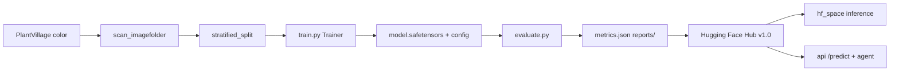

# Plant leaf disease model (Phase 1)

Fine-tuned **MobileNetV2** on the **PlantVillage** dataset for 38 crop-disease classes. The release
used in the API and Hugging Face Space is published at:

**https://huggingface.co/neghani/plantvillage-mobilenetv2** (revision **`v1.0`**)

| | |
|---|---|
| **Owners** | Ganesh, Shravanya (proposal Annex A) |
| **Hub account** | `neghani` |
| **Project** | IIIT-H Group 4 — AI-powered plant disease detection and farmer assistance |

---

## Model at a glance

| Item | Value |
|---|---|
| **Architecture** | [`google/mobilenet_v2_1.0_224`](https://huggingface.co/google/mobilenet_v2_1.0_224) |
| **Task** | Multi-class image classification (RGB leaf photos) |
| **Output** | One of 38 PlantVillage labels + softmax confidence (e.g. `Tomato___Early_blight`) |
| **Input size** | 224×224 centre crop after resize (via `AutoImageProcessor` / `preprocessor_config.json`) |
| **Classes** | 38 labels across **14 crops** (apple, blueberry, cherry, corn, grape, orange, peach, pepper, potato, raspberry, soybean, squash, strawberry, tomato) |
| **Training** | Full fine-tune (ImageNet head replaced); **5 epochs**, seed **42** |
| **Framework** | PyTorch + Hugging Face `transformers` `Trainer` |

### Published scores (PlantVillage held-out **test** split)

From [`reports/metrics.json`](https://huggingface.co/neghani/plantvillage-mobilenetv2/blob/v1.0/reports/metrics.json) on the Hub (`v1.0`, **5,430** test images):

| Metric | Score |
|---|---|
| **Accuracy (top-1)** | **99.12%** |
| **Top-3 accuracy** | **99.94%** |
| **Macro F1** | **98.58%** |
| **Macro precision** | 98.88% |
| **Macro recall** | 98.43% |
| **Weighted F1** | 99.12% |

**Recommended confidence threshold** (from test-split sweep): **0.50** — lowest threshold where
accuracy on covered images is ≥97% while keeping ≥50% coverage. The API may use a different value
after field tuning; see `api/app/config.py`.

**How to read these numbers:** Test metrics are **in-distribution** on PlantVillage-style photos.
The Kaggle release includes many near-duplicate shots of the same leaf; our split is **random per
image** (not grouped by leaf), so test accuracy can be **optimistic**. Treat **real-world
evaluation** as the honest demo metric (target ≥50% top-1 on internet field photos). See
[Limitations](#limitations).

**Weaker classes on test** (lowest macro-F1 contributors): corn gray leaf spot / northern leaf
blight (~0.91–0.95 F1). Full per-class table: Hub `reports/classification_report.txt` and
`reports/confusion_matrix.png`.

### Real-world score (Cropped-PlantDoc, published on the Hub card)

Evaluated on 2026-10-11 on the 50-image [real-world set](data/real_world_set/README.md) through the
**live-app chain** (shared gate + crop strategy B → `v1.0` on the 256×256 crop, threshold 0.85,
both chosen on tune with [`eval_strategies.py`](eval_strategies.py)) with
[`eval_real_world_set.py`](eval_real_world_set.py) and [`app_predictor.py`](app_predictor.py):

| Split | Images | Gate rejects | Top-1 (reached model) | Top-3 | End-to-end pass rate (95% CI) |
|---|---|---|---|---|---|
| tune | 25 | 0 | 4/25 (16.0%) | 7/25 (28.0%) | 2/25 (8.0%, 2.2–25.0%) |
| **final** (reported) | 25 | 0 | **3/25 (12.0%)** | 5/25 (20.0%) | **3/25 (12.0%, 4.2–30.0%)** |
| all | 50 | 0 | 7/50 (14.0%) | 12/50 (24.0%) | 5/50 (10.0%, 4.3–21.4%) |

With 25 images per split the intervals are wide. Raising the threshold from 0.5 to 0.85 kept the
pass rate and cut confident-but-wrong answers on final from 14 to 8; no threshold reached 70%
correct "ok" answers on tune (best 25%).

This is **well below the 50% target**. It is the model, not the preprocessing: classifying the
full frame instead of the leaf crop gives 7/50 top-1 vs 6/50. Typical errors: healthy leaves of
one crop predicted as another crop (often strawberry or tomato), and corn rust / northern leaf
blight predicted as gray leaf spot. Thresholds 0.5 and 0.6 gave the same tune-split pass rate.

Hub files: card section "Real-world images", `reports/real_world_set/{tune,final,all}/`, and
`real_world_set/` (labels, sources, build script; images are not redistributed).

```bash
python model/eval_real_world_set.py --set_dir model/data/real_world_set --split final \
  --predictor app_predictor:diagnose --strategy B --threshold 0.85 --push   # --push rewrites the Hub card (final only)
```

**On Colab** this is notebook section 7 (also runnable without training: sections 1, 2, 7). The set
comes from `MyDrive/plant-disease/real_world_set.zip`; with `--only_if_changed` the card is
regenerated only when the set fingerprint (labels.csv + every image), the weights (sha256 of
`model.safetensors`) or the threshold differ from `reports/real_world_set/<split>/run.json` on the
Hub, or when the card no longer shows the current fingerprint (e.g. `evaluate.py --push` or
`publish.py` uploaded a fresh template). When testing a local run dir, the updated card is also
written to `<run>/README.md` so `publish.py` uploads it.

### Crop strategy comparison

[`eval_strategies.py`](eval_strategies.py) compares five ways of turning a photo into classifier
input (`shared/vision/strategies.py`): **A** whole frame, **B** sharpest leaf (current), **C** most
symptomatic leaf, **D** top-3 leaves with averaged softmax and an agreement check, **E** tight
patch on the strongest symptom (control). It runs on `data/real_world_set/` plus our own
multi-leaf phone photos in [`data/full_photos/`](data/full_photos/README.md), sweeps the
confidence threshold on the tune split, and applies a selection rule fixed in the script
docstring (B is kept unless another strategy wins by at least 5 points with a bootstrap interval
that excludes 0).

```bash
python model/eval_strategies.py --split tune                                 # A-E comparison
python model/eval_strategies.py --split final --strategy B --threshold 0.85  # once, chosen values
```

Outputs in `model/outputs/`: `strategy_comparison.{csv,md}`, `strategy_threshold_sweep.csv`,
`per_image.csv`, `selection.json`; the final run writes `final_report.md` and refuses to run a
second time on the same final set. The chosen strategy and threshold go into
`api/app/config.py` (`crop_strategy`, `confidence_threshold`).

The older [`real_world_eval.py`](real_world_eval.py) (full frame, images under
[`data/real_world/`](data/real_world/README.md)) still works for ad-hoc photo folders. See
[`docs/challenges-and-approach.md`](../docs/challenges-and-approach.md) for the preprocessing.

---

## Dataset

### Source

- **Name:** [PlantVillage on Kaggle](https://www.kaggle.com/datasets/abdallahalidev/plantvillage-dataset)
- **Kaggle id:** `abdallahalidev/plantvillage-dataset` (also referenced as `KAGGLE_DATASET` in code)
- **Variant used:** **`color` only** — not grayscale or segmented folders. `resolve_data_dir()` in
  [`common.py`](common.py) auto-finds the `color` imagefolder under the download root.

### Layout

ImageFolder structure:

```text
color/
├── Tomato___Early_blight/
│   ├── image001.JPG
│   └── ...
├── Tomato___healthy/
└── ... (38 class folders)
```

Class folder names are the **model labels** and match keys in `api/data/knowledge/diseases.json`.

### Splits (release `v1.0`, seed 42)

Stratified **per class** (~80% / 10% / 10%), saved to `outputs/<run>/splits.json`:

| Split | Images |
|---|---|
| Train | 43,445 |
| Validation | 5,430 |
| Test | 5,430 |
| **Total** | **~54,305** |

Reproducibility: exact file lists live in `splits.json` on the Hub next to the weights.

### Real-world test set (separate from PlantVillage)

- **Path:** [`data/real_world_set/`](data/real_world_set/README.md) — 50 Cropped-PlantDoc images
  (Singh et al., 2020, CC BY 4.0), 27 classes mapped to PlantVillage labels, `labels.csv` with a
  `tune` / `final` split (25 / 25), `sources.csv` for attribution. Rebuilt deterministically by
  [`build_real_world_set.py`](build_real_world_set.py).
- **Purpose:** Field-style photos; proposal target **≥50%** end-to-end pass rate. Fix thresholds
  on `tune`, report `final` once.
- **Licence:** some images carry stock-photo watermarks; keep them in coursework / private repos.
  Only labels, sources and results are on the public Hub repo.
- **Ad-hoc photos:** [`data/real_world/`](data/real_world/README.md) (one folder per class, images
  git-ignored) for [`real_world_eval.py`](real_world_eval.py).

---

## MobileNetV2 training configuration

Recorded in Hub [`run_info.json`](https://huggingface.co/neghani/plantvillage-mobilenetv2/blob/v1.0/run_info.json) for `v1.0`:

| Hyperparameter | Value |
|---|---|
| Base checkpoint | `google/mobilenet_v2_1.0_224` |
| Epochs | 5 |
| Learning rate | 5×10⁻⁴ |
| Batch size (train) | 64 per device |
| Weight decay | 0.01 |
| LR schedule | Cosine |
| Warmup | 0.05 (ratio of steps) |
| Mixed precision | fp16 |
| Best checkpoint | Selected by **macro F1** on validation |
| Wall time (Colab T4) | ~493 s for full run |
| Backbone | **Not frozen** — end-to-end fine-tune |

**Fallback:** If MobileNetV2 underperforms on real-world photos, retrain with
`--model_name_or_path microsoft/resnet-50` (same scripts).

### Training augmentations (phone robustness)

[`train.py`](train.py) `build_transforms(..., is_training=True)`:

- Random resized crop (scale 0.7–1.0)
- Horizontal and vertical flip
- Rotation ±180°
- Color jitter (brightness/contrast/saturation; **hue 0.03**)
- Gaussian blur (p=0.25)

Eval transforms match the Hugging Face image processor: resize shortest edge → centre crop 224 →
ImageNet normalisation.

---

## Model code map

```text
model/
├── README.md                 This document
├── requirements.txt          Python dependencies (torch, transformers, …)
├── common.py                 Shared: HF token, dataset scan/split, quality gate (→ shared/), Predictor
├── train.py                  Fine-tune with HF Trainer → weights, splits.json, run_info.json
├── evaluate.py               Test metrics, confusion matrix, threshold sweep, model card
├── real_world_eval.py        Ad-hoc photo-folder benchmark (full frame)
├── eval_real_world_set.py    PlantDoc real-world set: report, CIs, Hub card section (--push)
├── eval_strategies.py        Crop strategies A-E: comparison, threshold sweep, final report
├── app_predictor.py          Live-app chain (shared gate + crop strategy → model) for the evals
├── build_real_world_set.py   Rebuild data/real_world_set from Cropped-PlantDoc (seed 42)
├── model_card_real_world_section.md  Template for the card's REAL_WORLD block
├── publish.py                Upload to Hub + tag v1.0
├── predict.py                Reference inference: quality → classify → ok / not_sure / retake
├── model_card_template.md    Hub README template (filled by evaluate.py)
├── data/
│   ├── plantvillage/         (git-ignored) optional local copy of Kaggle `color`
│   ├── real_world_set/       50 labelled PlantDoc images, labels.csv, sources.csv
│   ├── full_photos/          our own multi-leaf phone photos, labels.csv (images git-ignored)
│   └── real_world/           Ad-hoc field test images + sources.csv
└── outputs/                  (git-ignored) checkpoints and reports
```

### Pipeline flow



### Key modules

| Module | Responsibility |
|---|---|
| **`common.Predictor`** | Load Hub or local dir; `AutoImageProcessor` + `AutoModelForImageClassification`; softmax top-k |
| **`common.check_image_quality`** | Thin wrapper over the API's gate in `shared/vision/quality.py` (one implementation). Used by `real_world_eval.py`. |
| **`train.py`** | Builds HF `Dataset`, on-the-fly `pixel_values`, metrics: accuracy, macro F1, top-3 |
| **`evaluate.py`** | Batch inference on test split; writes `metrics.json`, plots, fills model card |
| **`predict.diagnose()`** | JSON result for API contract: `ok` \| `not_sure` \| `retake_photo` |

**Production note:** The live app and these scripts share `shared/vision/` (leaf finder, gate, crop
strategies). It downscales large photos, finds leaf candidates, applies a scale-normalised
sharpness gate, and sends **256×256** crop JPEGs to the Space. `predict.py --strategy A` classifies
the full frame.

---

## Quick start

### Install

```bash
python -m venv .venv && source .venv/bin/activate
pip install -r model/requirements.txt
```

Set `HF_TOKEN` in repo-root `.env` for Hub push (write token).

### Download PlantVillage

```bash
python - <<'EOF'
import kagglehub
print(kagglehub.dataset_download("abdallahalidev/plantvillage-dataset"))
EOF
export DATA_DIR=<printed path>
```

### Smoke test (CPU-friendly)

```bash
python model/train.py --data_dir "$DATA_DIR" --crop_filter Tomato --max_samples_per_class 40 \
  --output_dir model/outputs/smoke --do_train --do_eval --num_train_epochs 1 \
  --per_device_train_batch_size 16 --learning_rate 5e-4 --report_to none --save_strategy no
python model/evaluate.py --model model/outputs/smoke
python model/predict.py path/to/leaf.jpg --model model/outputs/smoke
```

### Full training + publish (GPU, e.g. Colab)

See [`../notebooks/phase1_plantvillage_mobilenetv2.ipynb`](../notebooks/phase1_plantvillage_mobilenetv2.ipynb)
or:

```bash
python model/train.py \
  --model_name_or_path google/mobilenet_v2_1.0_224 \
  --data_dir "$DATA_DIR" \
  --output_dir model/outputs/plantvillage-mobilenetv2 \
  --do_train --do_eval --num_train_epochs 5 \
  --per_device_train_batch_size 64 --learning_rate 5e-4 \
  --weight_decay 0.01 --warmup_steps 0.05 --lr_scheduler_type cosine \
  --fp16 --eval_strategy epoch --save_strategy epoch --save_total_limit 2 \
  --load_best_model_at_end --metric_for_best_model macro_f1 \
  --seed 42 --push_to_hub --hub_model_id neghani/plantvillage-mobilenetv2

python model/evaluate.py --model model/outputs/plantvillage-mobilenetv2 --push
for s in tune final; do python model/eval_real_world_set.py --set_dir model/data/real_world_set --split $s \
  --predictor app_predictor:diagnose --threshold 0.5 --model model/outputs/plantvillage-mobilenetv2 \
  --out model/outputs/real_world/$s --push --only_if_changed; done
python model/publish.py --tag v1.0
```

**Colab workflow:** Edit code locally → `git push` → `python notebooks/colab_sync.py` in Colab (do
not upload stale `.py` files manually).

---

## Evaluation artifacts

After `evaluate.py`, see `outputs/<run>/reports/`:

| File | Contents |
|---|---|
| `metrics.json` | Accuracy, F1, top-3, per-class metrics, recommended threshold |
| `classification_report.txt` | sklearn per-class report |
| `confusion_matrix.png` | Row-normalised confusion matrix |
| `threshold_sweep.csv` | Coverage vs accuracy for thresholds 0.50–0.95 |

After `real_world_eval.py`: `real_world_results.json`, `real_world_predictions.csv`, and an updated
“Real-world images” section in the Hub README.

After `eval_real_world_set.py --out model/outputs/real_world/<split>`: `results.csv` (per image),
`report.md` (summary, per class, top mistakes) and `model_card_section.md` (the card block).

---

## Inference examples

**From Python (Hub):**

```python
from transformers import pipeline

clf = pipeline(
    "image-classification",
    model="neghani/plantvillage-mobilenetv2",
    revision="v1.0",
)
preds = clf("leaf.jpg", top_k=3)
```

**Phase 1 reference (quality + threshold):**

```bash
python model/predict.py leaf.jpg --model neghani/plantvillage-mobilenetv2 --revision v1.0 --threshold 0.5
```

**Hosted Space:** [`hf_space/`](../hf_space/) — same weights, CPU `pipeline` at startup.

---

## Handover to API / agent (Phase 5)

| Item | Value |
|---|---|
| `HF_MODEL_ID` | `neghani/plantvillage-mobilenetv2` |
| `HF_MODEL_REVISION` | `v1.0` |
| Labels | `config.json` `id2label` ↔ `api/data/knowledge/diseases.json` (38 entries) |
| Confidence | Start from Hub `reports/metrics.json` → `recommended_confidence_threshold`; tune on real-world data |
| Reference logic | [`predict.py`](predict.py) `diagnose()` |
| Vision preprocess | `shared/vision/` (used by both `api/` and `model/`); strategy via `CROP_STRATEGY` |

---

## Limitations

- **Lab vs field:** PlantVillage uses plain backgrounds; field photos need leaf cropping and often score lower.
- **Split leakage:** Random per-image splits can place near-duplicate leaves in both train and test.
- **Closed set:** The model always outputs one of 38 classes; unknown plants or non-leaves can get high-confidence wrong answers (mitigated partly by crop hint and “unsupported crop” in the agent — see `docs/challenges-and-approach.md`).
- **Softmax confidence** is not calibrated out-of-distribution.

---

## Related docs

- [`model_card_template.md`](model_card_template.md) — Hub-facing model card
- [`data/real_world/README.md`](data/real_world/README.md) — collecting field test images
- [`../docs/challenges-and-approach.md`](../docs/challenges-and-approach.md) — preprocessing, agent, open issues
- [`../docs/demo-day-prep-guide.md`](../docs/demo-day-prep-guide.md) — Q&A and demo narrative
